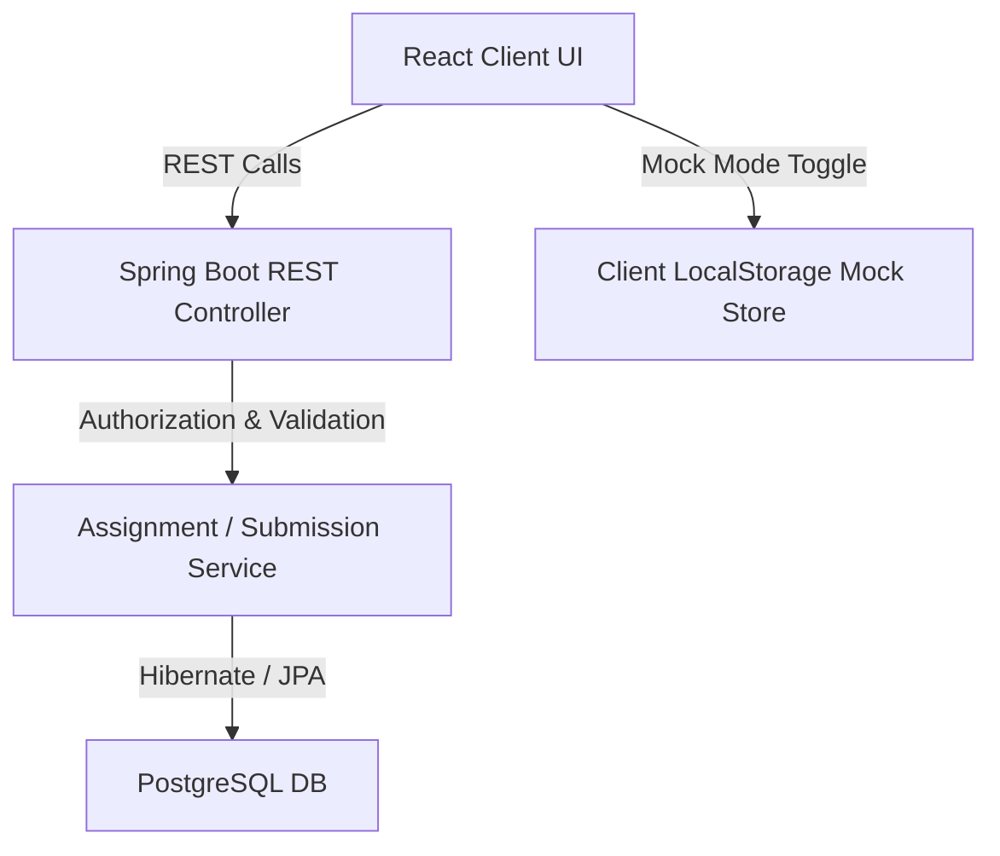
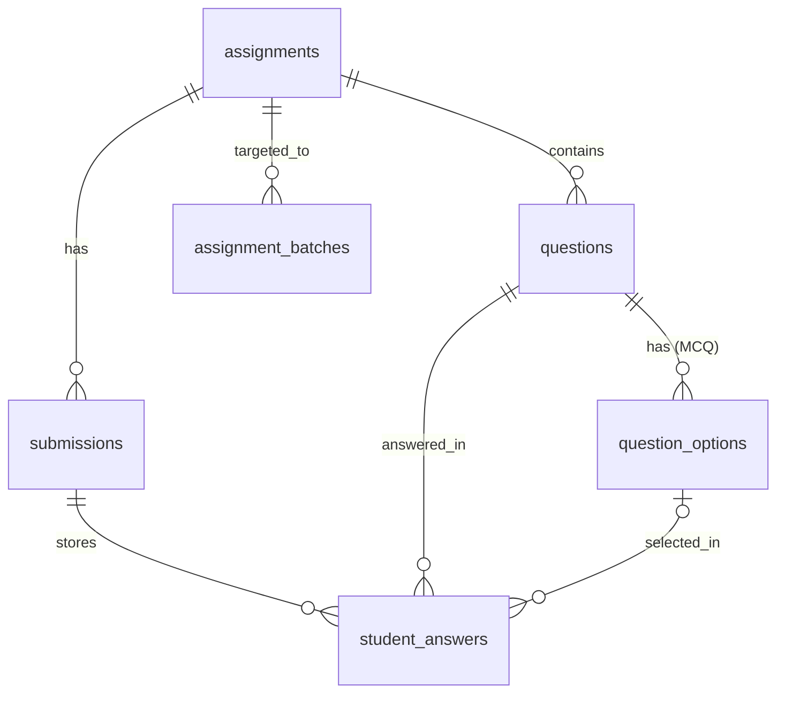

# Assignment Module Documentation

---

# Table of Contents
1. [1. Module Overview](#1-module-overview)
    - [Purpose](#purpose)
    - [Business Goal](#business-goal)
    - [Supported Roles](#supported-roles)
    - [High-Level Architecture](#high-level-architecture)
    - [System Dependencies](#system-dependencies)
2. [2. Database Design](#2-database-design)
    - [assignments Table (`AssignmentEntity`)](#assignments-table-assignmententity)
    - [submissions Table (`SubmissionEntity`)](#submissions-table-submissionentity)
    - [questions Table (`QuestionEntity`)](#questions-table-questionentity)
    - [question_options Table (`QuestionOptionEntity`)](#question_options-table-questionoptionentity)
    - [student_answers Table (`StudentAnswerEntity`)](#student_answers-table-studentanswerentity)
    - [Enums & Supporting Entities](#enums--supporting-entities)
3. [3. Codebase File Structure](#3-codebase-file-structure)
    - [Backend Directory Mapping](#backend-directory-mapping)
    - [Frontend Directory Mapping](#frontend-directory-mapping)
4. [4. Feature Flows & Method Call Paths](#4-feature-flows--method-call-paths)
    - [Feature 1: Assignment Creation & Batch Association](#feature-1-assignment-creation--batch-association)
    - [Feature 2: Student Assignment Workspace (Dashboard, Attempt, Auto-Save, and Submission)](#feature-2-student-assignment-workspace-dashboard-attempt-auto-save-and-submission)
    - [Feature 3: Grading & Instructor Feedback](#feature-3-grading--instructor-feedback)
    - [Feature 4: Analytical Data Export](#feature-4-analytical-data-export)
5. [5. Mismatches and Partial Implementations](#5-mismatches-and-partial-implementations)

---

# 1. Module Overview

### Purpose
The Assignment Module is a core component of the Executive Learning System (ELS) designed to deliver, monitor, and assess structured student evaluations. It allows educators to configure rich, multi-type assignments, target them toward specific user cohorts (batches), evaluate student submissions, provide granular or general feedback, and export cohort analytics.

### Business Goal
To support executive-level educational compliance and high-fidelity competency tracking. The system minimizes data loss during exams via robust, automatic client-side and backend draft-saving mechanisms and enforces academic integrity using strict evaluation and late-submission controls.

### Supported Roles
1. **Student**: View active, completed, overdue, and upcoming assignments; attempt timed assessments; save intermediate progress; submit final responses; and review graded performance sheets, feedback, and certifications.
2. **Teacher (Instructor)**: Create, update, publish, or archive assignments; set time limits and due dates; manage questions and multiple-choice options; grade submissions; and export comprehensive Excel performance matrices.
3. **Admin (Administrator)**: Oversee all system assignments, manage associations across batches, and access full cross-system submission reports.

### High-Level Architecture
The module employs a full-stack architecture consisting of a **Spring Boot REST API backend** backed by a PostgreSQL relational database and a **React (TypeScript) Single Page Application frontend** powered by Vite, Tailwind CSS, and TanStack React Query.



### System Dependencies
- **Authentication**: All endpoints verify the user through Spring Security contexts. The frontend relies on `/frontend/src/context/AppContext.tsx` to retrieve active user credentials and session roles.
- **Courses**: Assignments must be linked to a parent Course entity (`CourseEntity`).
- **Users**: Integrates with `/backend/src/main/java/com/geeknito/geeknito_backend/user/repository/UserRepository.java` to track student ownership (`student_id`) and instructor authorship (`teacher_id`).
- **Batches**: Restricts students from attempting assignments unless their active batch (`BatchStudentEntity` status is `ACTIVE`) is explicitly linked to the assignment via the `AssignmentBatchEntity` mapping.
- **Notifications**: (Partially Implemented) Triggers real-time alerts or emails to students upon assignment publication or evaluation completion.
- **Dashboard**: Aggregates total assignment metrics, average grades, and timeline distributions.
- **File Upload**: Handles the ingestion of PDF/image attachments for `FileUpload` question types via secure object storage configurations.

---

# 2. Database Design

All entities are mapped using JPA (`jakarta.persistence`) annotations and inherit direct indices and schema constraints.



### assignments Table (`AssignmentEntity`)
- **Database Table Name**: `assignments`
- **Source File**: `/backend/src/main/java/com/geeknito/geeknito_backend/entity/learning/AssignmentEntity.java`
- **Fields**:
  - `id` (`Long`, Primary Key, Auto-increment)
  - `title` (`String`, `nullable = false`) - *Validation*: `@NotBlank(message = "Assignment title is required")`
  - `description` (`String`, `columnDefinition = "TEXT"`, optional)
  - `instructions` (`String`, `columnDefinition = "TEXT"`, optional)
  - `course_id` (`Long`, Foreign Key, `nullable = false`) - Links to `CourseEntity`. *Validation*: `@NotNull`
  - `teacher_id` (`Long`, Foreign Key, `nullable = false`) - Links to `UserEntity`. *Validation*: `@NotNull`
  - `status` (`AssignmentStatus`, Enum as String, `length = 50`, Default: `DRAFT`)
  - `available_from` (`LocalDateTime`, optional)
  - `due_date` (`LocalDateTime`, optional)
  - `max_marks` (`Integer`, `nullable = false`, Default: `100`) - *Validation*: `@Min(1)`
  - `passing_marks` (`Integer`, `nullable = false`, Default: `40`) - *Validation*: `@Min(0)`
  - `time_limit_minutes` (`Integer`, `nullable = false`, Default: `0` - indicates no limit) - *Validation*: `@Min(0)`
  - `allow_late_submission` (`boolean`, `nullable = false`, Default: `false`)
  - `shuffle_questions` (`boolean`, `nullable = false`, Default: `false`)
  - `show_result_immediately` (`boolean`, `nullable = false`, Default: `true`)
  - `max_attempts` (`Integer`, optional)
  - `auto_submit` (`boolean`, `nullable = false`, Default: `true`)
  - `shuffle_options` (`boolean`, `nullable = false`, Default: `true`)
  - `negative_marking` (`boolean`, `nullable = false`, Default: `false`)
  - `show_detailed_answers` (`boolean`, `nullable = false`, Default: `false`)
  - `enable_certificates` (`boolean`, `nullable = false`, Default: `false`)
  - `is_active` (`boolean`, `nullable = false`, Default: `true`)
  - `created_at` (`LocalDateTime`, Auto-populated by Hibernate `@CreationTimestamp`, unmodifiable)
  - `updated_at` (`LocalDateTime`, Auto-populated by Hibernate `@UpdateTimestamp`)
- **Indexes**:
  - `idx_assignments_course` on (`course_id`)
  - `idx_assignments_teacher` on (`teacher_id`)
  - `idx_assignments_status` on (`status`)
  - `idx_assignments_available_from` on (`available_from`)
  - `idx_assignments_due_date` on (`due_date`)
- **Relationships**:
  - `@ManyToOne` (Fetch: `LAZY`) -> `CourseEntity` (`course_id`)
  - `@ManyToOne` (Fetch: `LAZY`) -> `UserEntity` (`teacher_id`)
  - `@OneToMany` (Cascade: `ALL`, orphanRemoval = `true`, Fetch: `LAZY`) -> `List<AssignmentBatchEntity>` mapped by `assignment`

### submissions Table (`SubmissionEntity`)
- **Database Table Name**: `submissions`
- **Source File**: `/backend/src/main/java/com/geeknito/geeknito_backend/entity/learning/SubmissionEntity.java`
- **Fields**:
  - `id` (`Long`, Primary Key, Auto-increment)
  - `assignment_id` (`Long`, Foreign Key, `nullable = false`) - *Validation*: `@NotNull`
  - `student_id` (`Long`, Foreign Key, `nullable = false`) - *Validation*: `@NotNull`
  - `status` (`SubmissionStatus`, Enum as String, Default: `IN_PROGRESS`)
  - `started_at` (`LocalDateTime`, optional)
  - `submitted_at` (`LocalDateTime`, optional)
  - `total_marks` (`Integer`, optional)
  - `obtained_marks` (`Integer`, optional)
  - `percentage` (`BigDecimal`, Precision: 5, Scale: 2, optional)
  - `time_taken_minutes` (`Integer`, optional)
  - `is_late_submission` (`boolean`, `nullable = false`, Default: `false`)
  - `created_at` (`LocalDateTime`, Auto-populated, unmodifiable)
  - `updated_at` (`LocalDateTime`, Auto-populated)
- **Indexes**:
  - `idx_submissions_assignment` on (`assignment_id`)
  - `idx_submissions_student` on (`student_id`)
  - `idx_submissions_status` on (`status`)
  - `idx_submissions_submitted_at` on (`submitted_at`)
- **Relationships**:
  - `@ManyToOne` (Fetch: `LAZY`) -> `AssignmentEntity` (`assignment_id`)
  - `@ManyToOne` (Fetch: `LAZY`) -> `UserEntity` (`student_id`)
  - `@OneToMany` (Cascade: `ALL`, orphanRemoval = `true`, Fetch: `LAZY`) -> `List<StudentAnswerEntity>` mapped by `submission`

### questions Table (`QuestionEntity`)
- **Database Table Name**: `questions`
- **Source File**: `/backend/src/main/java/com/geeknito/geeknito_backend/entity/learning/QuestionEntity.java`
- **Fields**:
  - `id` (`Long`, Primary Key, Auto-increment)
  - `assignment_id` (`Long`, Foreign Key, `nullable = false`) - *Validation*: `@NotNull`
  - `title` (`String`, `nullable = false`, `columnDefinition = "TEXT"`) - *Validation*: `@NotBlank(message = "Question title is required")`
  - `description` (`String`, `columnDefinition = "TEXT"`, optional)
  - `question_type` (`QuestionType`, Enum as String, `nullable = false`, `length = 50`) - *Validation*: `@NotNull`
  - `marks` (`Integer`, `nullable = false`, Default: `1`) - *Validation*: `@Min(1)`
  - `display_order` (`Integer`, `nullable = false`, Default: `0`) - *Validation*: `@NotNull`
  - `required` (`boolean`, `nullable = false`, Default: `true`)
  - `negative_marks` (`Integer`, `nullable = false`, Default: `0`) - *Validation*: `@NotNull`
  - `created_at` (`LocalDateTime`, Auto-populated, unmodifiable)
  - `updated_at` (`LocalDateTime`, Auto-populated)
- **Indexes**:
  - `idx_questions_assignment` on (`assignment_id`)
  - `idx_questions_display_order` on (`display_order`)
- **Relationships**:
  - `@ManyToOne` (Fetch: `LAZY`) -> `AssignmentEntity` (`assignment_id`)
  - `@OneToMany` (Cascade: `ALL`, orphanRemoval = `true`, Fetch: `LAZY`) -> `List<QuestionOptionEntity>` mapped by `question`

### question_options Table (`QuestionOptionEntity`)
- **Database Table Name**: `question_options`
- **Source File**: `/backend/src/main/java/com/geeknito/geeknito_backend/entity/learning/QuestionOptionEntity.java`
- **Fields**:
  - `id` (`Long`, Primary Key, Auto-increment)
  - `question_id` (`Long`, Foreign Key, `nullable = false`) - *Validation*: `@NotNull`
  - `option_text` (`String`, `nullable = false`, `columnDefinition = "TEXT"`) - *Validation*: `@NotBlank`
  - `is_correct` (`boolean`, `nullable = false`, Default: `false`)
  - `display_order` (`Integer`, `nullable = false`, Default: `0`) - *Validation*: `@NotNull`
- **Indexes**:
  - `idx_question_options_question` on (`question_id`)
  - `idx_question_options_display_order` on (`display_order`)
- **Relationships**:
  - `@ManyToOne` (Fetch: `LAZY`) -> `QuestionEntity` (`question_id`)

### student_answers Table (`StudentAnswerEntity`)
- **Database Table Name**: `student_answers`
- **Source File**: `/backend/src/main/java/com/geeknito/geeknito_backend/entity/learning/StudentAnswerEntity.java`
- **Fields**:
  - `id` (`Long`, Primary Key, Auto-increment)
  - `submission_id` (`Long`, Foreign Key, `nullable = false`) - *Validation*: `@NotNull`
  - `question_id` (`Long`, Foreign Key, `nullable = false`) - *Validation*: `@NotNull`
  - `selected_option_id` (`Long`, Foreign Key, optional)
  - `answer_text` (`String`, `columnDefinition = "TEXT"`, optional) - Stores short text, paragraph essay text, or stringified code metadata.
  - `uploaded_file_url` (`String`, `length = 512`, optional) - Stores files uploaded for validation.
  - `obtained_marks` (`Integer`, optional)
  - `teacher_feedback` (`String`, `columnDefinition = "TEXT"`, optional)
  - `created_at` (`LocalDateTime`, Auto-populated, unmodifiable)
  - `updated_at` (`LocalDateTime`, Auto-populated)
- **Indexes**:
  - `idx_student_answers_submission` on (`submission_id`)
  - `idx_student_answers_question` on (`question_id`)
- **Relationships**:
  - `@ManyToOne` (Fetch: `LAZY`) -> `SubmissionEntity` (`submission_id`)
  - `@ManyToOne` (Fetch: `LAZY`) -> `QuestionEntity` (`question_id`)
  - `@ManyToOne` (Fetch: `LAZY`) -> `QuestionOptionEntity` (`selected_option_id`)

### Enums & Supporting Entities
- **`AssignmentStatus`**: `/backend/src/main/java/com/geeknito/geeknito_backend/entity/learning/AssignmentStatus.java` (Values: `DRAFT`, `PUBLISHED`, `CLOSED`, `ARCHIVED`)
- **`SubmissionStatus`**: `/backend/src/main/java/com/geeknito/geeknito_backend/entity/learning/SubmissionStatus.java` (Values: `IN_PROGRESS`, `SUBMITTED`, `LATE_SUBMITTED`, `GRADED`)
- **`QuestionType`**: `/backend/src/main/java/com/geeknito/geeknito_backend/entity/learning/QuestionType.java` (Values: `MCQ`, `MULTIPLE_CORRECT`, `TRUE_FALSE`, `SHORT_ANSWER`, `PARAGRAPH`, `FILE_UPLOAD`)
- **`AssignmentBatchEntity`**: `/backend/src/main/java/com/geeknito/geeknito_backend/entity/learning/AssignmentBatchEntity.java` (Maps assignments to specific class `BatchEntity` structures).

---

# 3. Codebase File Structure

### Backend Directory Mapping
The backend code lives under `/backend/src/main/java/com/geeknito/geeknito_backend/`:
```
├── entity/learning/
│   ├── AssignmentBatchEntity.java      # Assignment-to-Batch Mapping
│   ├── AssignmentEntity.java           # DB Assignment Definition
│   ├── AssignmentStatus.java           # Draft/Published/Closed/Archived
│   ├── QuestionEntity.java             # Question DB Structure
│   ├── QuestionOptionEntity.java       # Multiple choice option fields
│   ├── QuestionType.java               # Enum: MCQ, FILE_UPLOAD, etc.
│   ├── StudentAnswerEntity.java        # Entity storing student answers
│   ├── SubmissionEntity.java           # Attempt and grade metadata
│   └── SubmissionStatus.java           # Enum: IN_PROGRESS, SUBMITTED, etc.
│
└── assignment/
    ├── controller/
    │   ├── AssignmentController.java    # Standard admin/instructor CRUD endpoints
    │   ├── ExportController.java        # XLSX spreadsheet download endpoints
    │   ├── QuestionController.java      # CRUD for questions & order adjustments
    │   └── SubmissionController.java    # Student workspace save/submit endpoints
    ├── dto/
    │   ├── AssignmentCreateRequestDTO.java
    │   ├── AssignmentResponseDTO.java
    │   ├── QuestionCreateRequestDTO.java
    │   ├── StudentAnswerCreateRequestDTO.java
    │   ├── SubmissionCreateRequestDTO.java
    │   └── SubmissionResponseDTO.java
    ├── repository/
    │   ├── AssignmentBatchRepository.java
    │   ├── AssignmentRepository.java
    │   ├── QuestionOptionRepository.java
    │   ├── QuestionRepository.java
    │   ├── StudentAnswerRepository.java
    │   └── SubmissionRepository.java
    └── service/
        ├── AssignmentService.java       # Assignment business interface
        ├── AssignmentServiceImpl.java   # Core CRUD and lifecycle engine
        ├── ExportService.java           # Analytics exporter interface
        ├── ExportServiceImpl.java       # Excel compilation engine (Apache POI)
        ├── QuestionService.java         # Question structure management
        ├── QuestionServiceImpl.java     # Displays/orders logic validator
        ├── SubmissionService.java       # Start, save, submit interface
        └── SubmissionServiceImpl.java   # Grading, late checking, & marks calculation
```

### Frontend Directory Mapping
The frontend modules are placed under `/frontend/src/modules/assignments/`:
```
├── api/
│   ├── assignmentService.ts          # Central client API with fallback mock stores
│   └── useAuthenticatedQuery.ts      # Custom hook wrapping react-query with auth headers
│
├── hooks/
│   └── useStudentAssignments.ts      # React hook wrapping react-query queries
│
├── shared/
│   ├── AssignmentCard.tsx            # Renders assignment stats and primary actions
│   ├── QuestionNavigator.tsx         # Sidebar index navigation grid with status dots
│   ├── ResultCard.tsx                # Visual analytics breakdown card for student scores
│   └── Timer.tsx                     # Active countdown countdown UI with auto-submission trigger
│
├── types.ts                          # Shared TypeScript types, interfaces, and maps
│
└── pages/
    ├── student/
    │   ├── StudentDashboard.tsx      # Grouped upcoming, ongoing, completed, and overdue tabs
    │   ├── AssignmentAttempt.tsx     # Timed testing workspace, auto-save, and uploading components
    │   └── ResultPage.tsx            # Displays detailed graded sheets and feedback review
    └── teacher/
        ├── CreateAssignmentWizard.tsx# Multistep wizard for configuring settings and adding questions
        ├── ReportsAnalytics.tsx      # Evaluator reports and analytic progress lists
        └── TeacherDashboard.tsx      # Cohort submission list with evaluation and grading modals
```

---

# 4. Feature Flows & Method Call Paths

---

## Feature 1: Assignment Creation & Batch Association

### Purpose
Allows instructors or administrators to define assignment configurations (title, instructions, grading values, timers, late rules, certificates) and map them to targeted cohort learning groups (batches).

### User Role
Teacher / Admin

---

### User Flow
```
Teacher opens Create Assignment page
↓
Fills in properties (title, Course ID, marks, timers)
↓
Frontend Route
/frontend/src/App.tsx
↓
Main Component
/frontend/src/modules/assignments/pages/teacher/CreateAssignmentWizard.tsx
↓
Add Questions Section (Adds MCQ options and types)
/frontend/src/modules/assignments/pages/teacher/CreateAssignmentWizard.tsx
↓
Wizard triggers save API call
/frontend/src/modules/assignments/api/assignmentService.ts (Method: createAssignment)
↓
Sends HTTP POST request to API route `/assignments`
↓
Backend Controller
/backend/src/main/java/com/geeknito/geeknito_backend/assignment/controller/AssignmentController.java (Method: createAssignment)
↓
Authentication & Role Check
/backend/src/main/java/com/geeknito/geeknito_backend/assignment/controller/AssignmentController.java (Method: validateAdminOrTeacher)
↓
Backend Service
/backend/src/main/java/com/geeknito/geeknito_backend/assignment/service/AssignmentServiceImpl.java (Method: createAssignment)
↓
Query and load course details and validation
/backend/src/main/java/com/geeknito/geeknito_backend/course/repository/CourseRepository.java (Method: findById)
↓
Persists Assignment Entity in Database
/backend/src/main/java/com/geeknito/geeknito_backend/assignment/repository/AssignmentRepository.java (Method: save)
↓
Optionally creates and chains associated Question and Options Entities
/backend/src/main/java/com/geeknito/geeknito_backend/assignment/repository/QuestionRepository.java (Method: save)
/backend/src/main/java/com/geeknito/geeknito_backend/assignment/repository/QuestionOptionRepository.java (Method: save)
↓
Database Commits the Transaction
PostgreSQL Database -> `assignments` & `questions` & `question_options` tables updated
↓
Returns `AssignmentResponseDTO` mapped to DTO layer
↓
React Client receives 201 Created and displays the assignment card.
```

### Method Flow Details
1. **Frontend**: `CreateAssignmentWizard.tsx` gathers state data and makes a call:
   ```typescript
   assignmentService.createAssignment(payload: any)
   ```
2. **REST Endpoints**:
   - `POST /assignments` -> Initiates creation of base assignment settings.
   - `PUT /assignments/{id}` -> Saves updates or transitions status to `PUBLISHED`.
   - `POST /assignments/{id}/batches?batchId=X` or body `[batchIds]` -> Maps assignment to student batches.
3. **Backend Service Methods**:
   - `AssignmentServiceImpl.createAssignment(AssignmentCreateRequestDTO)`: Parses the input, fetches the authoring Teacher and target Course, initializes default properties, and stores the database record.
   - `AssignmentServiceImpl.publishAssignment(Long id)`: Transitions status from `DRAFT` to `PUBLISHED` making it accessible to students in enrolled courses.
   - `AssignmentController.addBatchesToAssignment(Long id, Long batchId, List<Long> batchIds)`: Resolves batch records via `BatchRepository` and inserts records in `AssignmentBatchEntity` mapping table.

---

## Feature 2: Student Assignment Workspace (Dashboard, Attempt, Auto-Save, and Submission)

### Purpose
Allows students to browse assignments filtered by timeline statuses, launch timed workspace attempts, enter answers, execute sandbox script reviews, safely auto-save intermediate answers to prevent connection losses, and execute final submissions.

### User Role
Student

---

### User Flow
```
Student opens Student Dashboard
↓
Frontend Route
/frontend/src/App.tsx
↓
Dashboard Component
/frontend/src/modules/assignments/pages/student/StudentDashboard.tsx
↓
Renders course cards and loads current active assignments hook
/frontend/src/modules/assignments/hooks/useStudentAssignments.ts
↓
Calls api wrapper
/frontend/src/modules/assignments/api/assignmentService.ts (Method: getStudentAssignments)
↓
Sends GET `/assignments/student/me`
↓
Backend Controller
/backend/src/main/java/com/geeknito/geeknito_backend/assignment/controller/AssignmentController.java (Method: getMyStudentAssignments)
↓
Service queries published assignments targeted to student's active enrollment batches
/backend/src/main/java/com/geeknito/geeknito_backend/assignment/service/AssignmentServiceImpl.java (Method: getAssignmentsForStudent)
↓
Dashboard renders Ongoing/Upcoming/Overdue/Completed lists.
↓
Student clicks "Start Assignment" / "Resume Attempt"
↓
Frontend page route transitions to Active Testing Viewport
/frontend/src/modules/assignments/pages/student/AssignmentAttempt.tsx
↓
Initiates / Resumes submission via API
/frontend/src/modules/assignments/api/assignmentService.ts (Method: startAttempt)
↓
Sends POST `/submissions/start`
↓
Backend Controller
/backend/src/main/java/com/geeknito/geeknito_backend/assignment/controller/SubmissionController.java (Method: startSubmission)
↓
Backend Service
/backend/src/main/java/com/geeknito/geeknito_backend/assignment/service/SubmissionServiceImpl.java (Method: startSubmission)
↓
Validates eligibility (Enrolled, status is PUBLISHED, active student batch, max attempts not exceeded)
↓
Persists new/resumed submission record in `IN_PROGRESS` status
/backend/src/main/java/com/geeknito/geeknito_backend/assignment/repository/SubmissionRepository.java (Method: save)
↓
Returns `SubmissionResponseDTO` with current draft answers if resuming.
↓
Active countdown timer starts ticking
/frontend/src/modules/assignments/shared/Timer.tsx
↓
Student edits/updates an answer (e.g., changes MCQ selection or types essay)
↓
`AssignmentAttempt.tsx` fires a debounced auto-save mutation after 2 seconds of inactivity
↓
Frontend API
/frontend/src/modules/assignments/api/assignmentService.ts (Method: saveDraft)
↓
Sends PUT `/submissions/save?id=X`
↓
Backend Controller
/backend/src/main/java/com/geeknito/geeknito_backend/assignment/controller/SubmissionController.java (Method: saveDraft)
↓
Backend Service
/backend/src/main/java/com/geeknito/geeknito_backend/assignment/service/SubmissionServiceImpl.java (Method: saveDraft)
↓
Clears old intermediate answers and saves new ones in database
/backend/src/main/java/com/geeknito/geeknito_backend/assignment/repository/StudentAnswerRepository.java (Method: save)
↓
Timer counts down to 00:00 OR Student clicks "Submit Assignment" and confirms
↓
Calls submission API
/frontend/src/modules/assignments/api/assignmentService.ts (Method: submitAttempt)
↓
Sends POST `/submissions/submit?id=X`
↓
Backend Controller
/backend/src/main/java/com/geeknito/geeknito_backend/assignment/controller/SubmissionController.java (Method: submitAssignment)
↓
Backend Service
/backend/src/main/java/com/geeknito/geeknito_backend/assignment/service/SubmissionServiceImpl.java (Method: submitAssignment)
↓
Performs final validations (due date limits, late allowed constraints)
↓
Grades MCQ / True-False items immediately and adds points, transitions state to `SUBMITTED` or `LATE_SUBMITTED`
↓
Saves finalized obtained marks, percentage, and time taken metrics
/backend/src/main/java/com/geeknito/geeknito_backend/assignment/repository/SubmissionRepository.java (Method: save)
↓
Transaction completes. Redirects student to Result Page.
/frontend/src/modules/assignments/pages/student/ResultPage.tsx
```

### Method Flow Details
- **Eligibility Validation (Backend Service)**:
  `SubmissionServiceImpl.startSubmission` handles critical verification checks before initiating an assessment attempt:
  - Validates enrollment: `enrollmentRepository.existsByStudentIdAndCourseId(studentId, courseId)`
  - Validates active batch mapping: cross-checks `assignmentBatchRepository.findByAssignmentId` with active elements in `batchStudentRepository.findByStudentId`.
  - Enforces attempt count limit: counts completed submissions (`submissionRepository.countByAssignmentIdAndStudentIdAndStatusNot(..., IN_PROGRESS)`) and blocks startup if this count meets or exceeds `assignment.getMaxAttempts()`.
- **Auto-Save Mechanism**:
  `AssignmentAttempt.tsx` uses a React Ref `autosaveTimeout` to track user typing or selection updates. Any input change triggers:
  ```typescript
  const triggerAutosave = (currentAnswers: Answer[]) => { ... }
  ```
  This delays for 2000ms before dispatching `saveDraft` payload to the backend service. This prevents data loss in the event of local power issues, connection interruptions, or sudden window reloads.
- **Auto-Submission Trigger**:
  If the time limit is reached, `Timer.tsx` invokes `onTimeUp()`. This updates `isTimerExpiredState = true` in `AssignmentAttempt.tsx`.
  - If `assignment.autoSubmit` is `true` (or unset), it fires `executeSubmission()` to auto-submit current progress.
  - If `assignment.autoSubmit` is `false`, it locks the screen and issues a final `saveDraft` call, requiring the student to exit without submitting.
- **Immediate Grading of Closed Questions**:
  `SubmissionServiceImpl.submitAssignment` loops through the input answers. If the type is `MCQ`, `TRUE_FALSE`, or `MULTIPLE_CORRECT`, it queries the database choice:
  ```java
  answer.setObtainedMarks(answer.getSelectedOption().isCorrect() ? question.getMarks() : 0);
  ```
  It aggregates these scores to calculate `obtainedMarks` and the final `percentage` immediately, enabling an interactive real-time performance summary.

---

## Feature 3: Grading & Instructor Feedback

### Purpose
Allows instructors to view student attempts, read essay/paragraph entries, download submitted file attachments, assign manual points for open-ended questions, write constructive evaluation feedback, and commit finalized grades.

### User Role
Teacher / Admin

---

### User Flow
```
Teacher navigates to Teacher Dashboard
↓
Selects an Assignment and views Submissions List
↓
Frontend Route
/frontend/src/App.tsx
↓
Main Component
/frontend/src/modules/assignments/pages/teacher/TeacherDashboard.tsx
↓
Teacher clicks "Grade Submission" on a student item
↓
Opens Modal/Drawer showing student responses and grading text fields
↓
Teacher reviews essay/file responses and inputs scores and comments
↓
Clicks "Publish Grade"
↓
Frontend API
/frontend/src/modules/assignments/api/assignmentService.ts (Method: gradeSubmission)
↓
Sends POST `/submissions/{id}/grade` with marks, status, and feedbacks
↓
Backend Controller
/backend/src/main/java/com/geeknito/geeknito_backend/assignment/controller/SubmissionController.java (Method: gradeSubmission)
↓
Backend Service
/backend/src/main/java/com/geeknito/geeknito_backend/assignment/service/SubmissionServiceImpl.java (Method: gradeSubmission)
↓
Validates scores range (obtained marks cannot exceed question max value)
↓
Updates obtained marks and comments for each student answer row
/backend/src/main/java/com/geeknito/geeknito_backend/assignment/repository/StudentAnswerRepository.java (Method: save)
↓
Saves updated submission record status to `GRADED`
/backend/src/main/java/com/geeknito/geeknito_backend/assignment/repository/SubmissionRepository.java (Method: save)
↓
Refreshes evaluation interface; student can now see updated grade sheet in `ResultPage.tsx`.
```

### Method Flow Details
- **Backend Service Logic**:
  `SubmissionServiceImpl.gradeSubmission` accepts a `SubmissionUpdateRequestDTO` containing global scores and a collection of student answers.
  - It fetches the active submission: `submissionRepository.findById(id)`
  - Re-evaluates total marks if a manual override is supplied: `submission.setObtainedMarks(request.getObtainedMarks())`
  - Loops through `request.getAnswers()` and updates specific elements by matching answer/question ID structures:
    ```java
    answer.setObtainedMarks(ansReq.getObtainedMarks());
    answer.setTeacherFeedback(ansReq.getTeacherFeedback());
    ```
  - Transitions `SubmissionStatus` to `GRADED` (or other instructor-supplied statuses).

---

## Feature 4: Analytical Data Export

### Purpose
Enables instructors to export structural spreadsheets capturing cohort-wide performance metrics, timeline criteria, and submission statuses to use for offline compliance auditing.

### User Role
Teacher / Admin

---

### User Flow
```
Teacher navigates to Reports and Analytics
↓
Frontend Component
/frontend/src/modules/assignments/pages/teacher/ReportsAnalytics.tsx
↓
Clicks "Export Excel Report" for a selected assignment
↓
Frontend triggers direct window location / binary request redirect
↓
Sends HTTP GET request to `/export/assignment/{assignmentId}`
↓
Backend Controller
/backend/src/main/java/com/geeknito/geeknito_backend/assignment/controller/ExportController.java (Method: exportAssignmentResults)
↓
Verification Check (Requires Admin/Teacher credentials)
↓
Backend Service
/backend/src/main/java/com/geeknito/geeknito_backend/assignment/service/ExportServiceImpl.java (Method: exportAssignmentResults)
↓
Queries submissions associated with the assignment
/backend/src/main/java/com/geeknito/geeknito_backend/assignment/repository/SubmissionRepository.java (Method: findByAssignmentId)
↓
Initializes Excel workbook (using Apache POI library)
Creates headers: Student Name, Email, Status, Time Taken, Marks Obtained, Percentage, Grade, Submission Date
↓
Applies visual typography formatting to rows
↓
Streams binary output stream `ByteArrayInputStream` back to client
↓
Client browser downloads Excel file (e.g., `Assignment_Results_Export_12.xlsx`)
```

### Method Flow Details
- **Backend Service Methods**:
  - `ExportServiceImpl.exportAssignmentResults(Long assignmentId)`: Retrieves all student attempts from the database, maps each record to an `AssignmentExportRow` DTO model, initializes a POI `SXSSFWorkbook` to handle large row-sets without memory overhead, compiles cells, sets row dimensions, and returns a compiled binary workbook stream back to the controller.
  - `ExportServiceImpl.exportBatchStudents(Long batchId)`: Compiles directory spreadsheets detailing all students mapped to a specific training class cohort.

---

# 5. Mismatches and Partial Implementations

During the detailed analysis of the module codebase, several functional mismatches and partial implementations were identified between the React client and the Spring Boot backend:

1. **`Coding` Question Type (Mismatch)**:
   - *Frontend*: Implements a highly interactive coding question workspace (`q.type === "Coding"`) featuring a simulated file sandbox compiler, language selector, starter code template handler, and test case verification logs.
   - *Backend*: The backend schema does not natively define a `CODING` option in the `QuestionType` enum. The enum is limited to: `MCQ`, `MULTIPLE_CORRECT`, `TRUE_FALSE`, `SHORT_ANSWER`, `PARAGRAPH`, `FILE_UPLOAD`.
   - *Result*: The system is **Partially Implemented**. When saving or submitting coding responses, the frontend must submit them mapped as standard `SHORT_ANSWER` or `PARAGRAPH` entries under the hood, and automatic test grading is simulated on the client side (instructors must evaluate submitted scripts manually).

2. **Negative Marking (Partially Implemented)**:
   - *Backend*: The `AssignmentEntity` contains a database column `negative_marking` (`boolean`) and `QuestionEntity` includes a `negative_marks` field.
   - *Service*: In `SubmissionServiceImpl.populateAndValidateAnswers`, the automatic calculation of MCQ marks does not deduct points for incorrect options:
     ```java
     answer.setObtainedMarks(answer.getSelectedOption().isCorrect() ? question.getMarks() : 0);
     ```
     There is no logic checking if `negativeMarking` is enabled and applying deductions for wrong choices.
   - *Result*: Educators must apply manual deductions during grading.

3. **`MULTIPLE_CORRECT` Automatic Grading (Partially Implemented)**:
   - *Backend*: Supports `MULTIPLE_CORRECT` in the `QuestionType` enum.
   - *Service*: The immediate grading logic inside `SubmissionServiceImpl` handles `MULTIPLE_CORRECT` on submission by checking the selected option:
     ```java
     if (answer.getSelectedOption() != null) {
         answer.setObtainedMarks(answer.getSelectedOption().isCorrect() ? question.getMarks() : 0);
     }
     ```
     This is designed for single-select fields. A fully complete multiple-correct answer schema would require mapping multiple selected option IDs to a single question, rather than assigning maximum marks for any single correct selection.
   - *Result*: Instructors must manually review multiple-correct selections to ensure accuracy.

4. **Honor Code & Integrity Violation Flags (Client-Side Only)**:
   - *Frontend*: The client displays warnings detailing "Active Monitoring Engaged" and logs focus shifts (tab changes, screen minimize).
   - *Backend*: The `submissions` table does not contain a field for tracking "tab-out count", "suspicion flags", or "integrity telemetry log" reports.
   - *Result*: Integrity alerts are educational and informational deterrents displayed on the student's screen.
