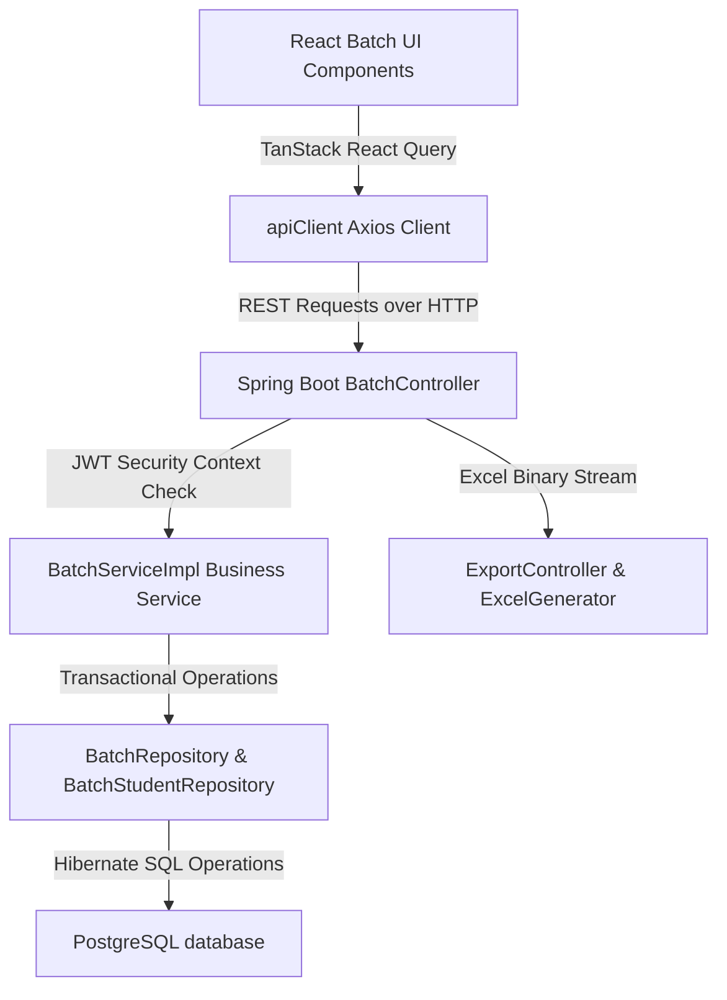
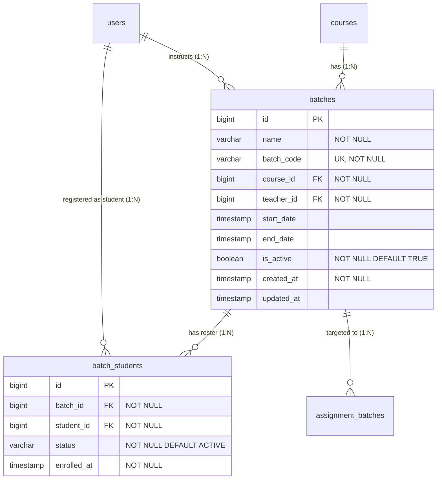
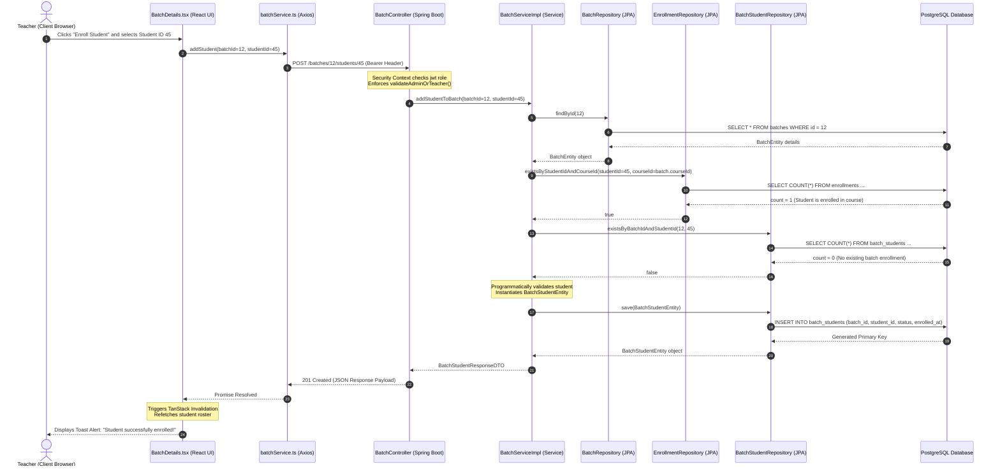

# Batch Module Documentation

---

# Table of Contents

- [1. Module Overview](#1-module-overview)
  - [Purpose of the Batch Module](#purpose-of-the-batch-module)
  - [Business Goal](#business-goal)
  - [Supported User Roles](#supported-user-roles)
  - [High Level Architecture](#high-level-architecture)
  - [Dependencies on Other Modules](#dependencies-on-other-modules)
- [2. Roles & Features](#2-roles--features)
  - [Student Features](#student-features)
  - [Teacher Features](#teacher-features)
  - [Admin Features](#admin-features)
  - [Shared Features](#shared-features)
- [3. Complete Module Architecture](#3-complete-module-architecture)
- [4. Database Design](#4-database-design)
  - [Entity Relationship Details](#entity-relationship-details)
- [5. Complete File Structure](#5-complete-file-structure)
  - [Frontend Module Structure](#frontend-module-structure)
  - [Backend Package Structure](#backend-package-structure)
- [6. Feature Documentation](#6-feature-documentation)
  - [Feature 1: Batch Lifecycle Management (Creation, Draft-Saving, Schedule Publishing)](#feature-1-batch-lifecycle-management-creation-draft-saving-schedule-publishing)
  - [Feature 2: Student Roster Enrollment (Pre-requisite Validation & Roster Changes)](#feature-2-student-roster-enrollment-pre-requisite-validation--roster-changes)
  - [Feature 3: Student & Instructor Interactive Workspaces](#feature-3-student--instructor-interactive-workspaces)
  - [Feature 4: Cohort Analytics & Excel Roster Export](#feature-4-cohort-analytics--excel-roster-export)
- [7. Module Flow](#7-module-flow)
- [8. API Reference](#8-api-reference)
- [9. Frontend Components Reference](#9-frontend-components-reference)
- [10. Backend Classes Reference](#10-backend-classes-reference)
- [11. Repository Methods](#11-repository-methods)
- [12. DTO Flow](#12-dto-flow)
- [13. Authentication & Authorization](#13-authentication--authorization)
- [14. Dependencies](#14-dependencies)
- [15. Performance Considerations](#15-performance-considerations)
- [16. Modification Guide](#16-modification-guide)
- [17. Troubleshooting](#17-troubleshooting)
- [18. Future Improvements](#18-future-improvements)
- [19. Summary](#19-summary)

---

# 1. Module Overview

### Purpose of the Batch Module
The **Batch Module** (or Cohort Module) serves as the primary organizational container of the LMS. It models a physical or virtual training cohort (batch) of students associated with a particular course, led by a dedicated teacher, and restricted to specific start and end schedules. 

### Business Goal
In enterprise and professional learning environments, education is delivered in structured cohort periods rather than single, self-paced individual courses. The Batch Module enables:
- High-fidelity compliance tracking by restricting enrollment timeline blocks.
- Resource allocation tracking by assigning a primary instructor (Teacher) to manage a capped seat-capacity roster.
- Seamless curriculum staging where course materials, announcements, calendars, and assignments can be targeted to specific cohorts.

### Supported User Roles
1. **Student (Learner)**: Accesses enrolled cohorts; views batch codes and active training calendars; browses class timelines; and consumes targeted cohort materials.
2. **Teacher (Instructor)**: Administrative ownership of assigned cohorts. Initiates setup of training batches; defines start/end boundaries; manages class capacities; reviews roster metrics; dismisses/adds student roster members; and exports class rosters.
3. **Admin (LMS Operator)**: Enjoys all Teacher features, with additional authority to override ownership checks across all batches, modify instructor assignments, and manage cross-system databases.

### High Level Architecture
The Batch Module utilizes a layered full-stack architectural framework:
- **Frontend Presentation Layer**: Built in **React 18** with **Vite**, using **Tailwind CSS** for responsive designs, **Lucide React** for consistent vector icons, and **TanStack React Query (v5)** for robust client-side caching and optimistic mutations.
- **Backend Request Controller Layer**: Exposes secure REST endpoints utilizing Spring Boot `@RestController` mapping endpoints under `/batches/**` and `/export/batch/**`.
- **Backend Service Layer**: An interface-driven architecture (`BatchService` and `BatchServiceImpl`) executing validations, handling transaction boundaries (`@Transactional`), and asserting ownership bounds.
- **Persistence Layer**: Relies on Spring Data JPA `JpaRepository` mappings on a relational PostgreSQL database to handle indexing and cascading deletions of records.



### Dependencies on Other Modules
- **Authentication Module**: Bridges authenticated user sessions and security context extraction. Endpoint-level and service-level operations verify role configurations (`ROLE_ADMIN`, `ROLE_TEACHER`, `ROLE_STUDENT`) using Spring Security.
- **User Module**: Bridges student profiles (`UserEntity`) into batch roster lists (`BatchStudentEntity`).
- **Course Module**: Batches cannot exist without referencing a parent Course entity (`CourseEntity`). Student enrollments must also be validated against course enrollments (`EnrollmentEntity`) before batch additions are pre-approved.
- **Assignment Module**: Assignments published to a course can be targeted to specific batches via `AssignmentBatchEntity` mapping tables. Batch-level evaluations and student results are compiled under the `ExportController`.

---

# 2. Roles & Features

## Student Features

### 1. Browse Enrolled Batches Dashboard
- **Purpose**: Students can view a dashboard displaying their currently assigned active, inactive, or completed learning cohorts.
- **Route**: `/student/batches`
- **Frontend Files**:
  - `/frontend/src/modules/batches/pages/StudentBatchDashboard.tsx`
  - `/frontend/src/modules/batches/components/BatchHeader.tsx`
- **Backend Files**:
  - `/backend/src/main/java/com/geeknito/geeknito_backend/batch/controller/BatchController.java` (specifically `getMyStudentBatches()`)
  - `/backend/src/main/java/com/geeknito/geeknito_backend/batch/service/BatchServiceImpl.java` (specifically `getBatchesForStudent()`)
- **APIs Used**: `GET /batches/student/me`

### 2. Interactive Cohort Workspace Portal
- **Purpose**: A dedicated study portal representing the cohort schedule, syllabus title, assigned co-teachers, assignments timeline, and announcements.
- **Route**: `/student/batches/:id`
- **Frontend Files**:
  - `/frontend/src/modules/batches/pages/StudentBatchDetails.tsx`
- **Backend Files**:
  - `/backend/src/main/java/com/geeknito/geeknito_backend/batch/controller/BatchController.java` (specifically `getMyStudentBatch()`)
  - `/backend/src/main/java/com/geeknito/geeknito_backend/batch/service/BatchServiceImpl.java` (specifically `getBatchForStudent()`)
- **APIs Used**: `GET /batches/student/me/{batchId}`

---

## Teacher Features

### 1. Batches Management Control Center
- **Purpose**: Teachers can view all cohorts they own, track metrics (roster sizes, active durations, fill rates), and initiate deletion, modification, or creation flows.
- **Route**: `/teacher/batches`
- **Frontend Files**:
  - `/frontend/src/modules/batches/pages/BatchDashboard.tsx`
  - `/frontend/src/modules/batches/components/BatchTable.tsx`
  - `/frontend/src/modules/batches/components/BatchMetricCard.tsx`
- **Backend Files**:
  - `/backend/src/main/java/com/geeknito/geeknito_backend/batch/controller/BatchController.java` (specifically `getMyBatches()`)
- **APIs Used**: `GET /batches/my`

### 2. Multi-Step Batch Creation & Draft Setup Engine
- **Purpose**: A comprehensive wizard guiding instructors through defining batch attributes, dates, linking curriculum courses, enrolling eligible students, and configuring draft vs active settings.
- **Route**: `/teacher/batches/create`
- **Frontend Files**:
  - `/frontend/src/modules/batches/pages/CreateBatchWizard.tsx`
- **Backend Files**:
  - `/backend/src/main/java/com/geeknito/geeknito_backend/batch/controller/BatchController.java` (`createBatch()`)
- **APIs Used**: `POST /batches`, `GET /courses`, `GET /users?role=TEACHER`, `GET /enrollments/eligible-students` (via `enrollmentService`)

### 3. Detailed Cohort Monitor Panel
- **Purpose**: Inspect a single batch. Includes monitoring the timeline progress bar, searching/filtering the active student roster, adding/dismissing students, viewing assigned assignments, and checking class performance charts.
- **Route**: `/teacher/batches/:id`
- **Frontend Files**:
  - `/frontend/src/modules/batches/pages/BatchDetails.tsx`
- **Backend Files**:
  - `/backend/src/main/java/com/geeknito/geeknito_backend/batch/controller/BatchController.java` (`getBatch()`, `getStudentsInBatch()`)
- **APIs Used**: `GET /batches/{id}`, `GET /batches/{batchId}/students`

### 4. Direct Student Enrollment & Dismissal
- **Purpose**: Instructors can dynamically manage roster changes on active cohorts.
- **Route**: Inside `/teacher/batches/:id` (Students Tab)
- **Frontend Files**:
  - `/frontend/src/modules/batches/pages/BatchDetails.tsx`
- **Backend Files**:
  - `/backend/src/main/java/com/geeknito/geeknito_backend/batch/controller/BatchController.java` (`addStudentToBatch()`, `removeStudentFromBatch()`)
- **APIs Used**: `POST /batches/{batchId}/students/{studentId}`, `DELETE /batches/{batchId}/students/{studentId}`

### 5. Cohort Spreadsheet Excel Export
- **Purpose**: Export a professionally structured Excel spreadsheet compiling the full student roster, enrollment statuses, join dates, and duration statistics.
- **Route**: Inside `/teacher/batches/:id` (Export Button)
- **Frontend Files**:
  - `/frontend/src/modules/batches/pages/BatchDetails.tsx` (`handleExportStudents()`)
- **Backend Files**:
  - `/backend/src/main/java/com/geeknito/geeknito_backend/assignment/controller/ExportController.java` (`exportBatchStudents()`)
  - `/backend/src/main/java/com/geeknito/geeknito_backend/assignment/service/ExportServiceImpl.java` (`exportBatchStudents()`)
  - `/backend/src/main/java/com/geeknito/geeknito_backend/assignment/util/ExcelGenerator.java` (`generateBatchStudents()`)
- **APIs Used**: `GET /export/batch/{batchId}`

---

## Admin Features
- Admins possess all Teacher features but bypass all batch teacher ownership authorization checks. An Admin can read, modify, delete, enroll, or export data for any batch in the database, regardless of which instructor created it.

---

## Shared Features
- **Dynamic Status Styling**: Renders consistent status badges ('ACTIVE', 'INACTIVE', 'COMPLETED') across both Student and Teacher dashboards utilizing the reusable `BatchStatusBadge.tsx` component.
- **Date Boundary Enforcement**: Programmatically prevents creation of batches with start dates occurring after end dates.

---

# 3. Complete Module Architecture

The Batch Module leverages a highly decoupeled, testable architecture. Below is a structured block diagram mapping how requests and entities stream through the system layers:

```
+-------------------------------------------------------------------------------------------------+
|                                         PRESENTATION LAYER                                      |
|                                                                                                 |
|   +-----------------------+   +--------------------+   +-----------------------+                |
|   |   BatchDashboard      |   | BatchDetails       |   | CreateBatchWizard     |   React        |
|   +-----------+-----------+   +---------+----------+   +-----------+-----------+   Pages        |
|               |                         |                          |                            |
|               +-------------------------+--------------------------+                            |
|                                         |                                                       |
|                         +---------------+---------------+                                       |
|                         |  TanStack React Query Cache   |  Caching Hooks                        |
|                         +---------------+---------------+                                       |
|                                         |                                                       |
|                        +----------------v---------------+                                       |
|                        |     batchService (Axios)       |  API Gateway Wrappers                 |
|                        +----------------+---------------+                                       |
+-----------------------------------------|-------------------------------------------------------+
|                                         |  HTTP / REST JSON (Payloads / Blobs)                  |
+-----------------------------------------v-------------------------------------------------------+
|                                      BACKEND LAYER                                              |
|                                                                                                 |
|                         +---------------+---------------+                                       |
|                         |        BatchController        |  REST Controller                      |
|                         |       ExportController        |                                       |
|                         +---------------+---------------+                                       |
|                                         |                                                       |
|                         +---------------+---------------+                                       |
|                         |          BatchService         |  Service Layer Interface              |
|                         +---------------+---------------+                                       |
|                                         |                                                       |
|                         +---------------+---------------+                                       |
|                         |        BatchServiceImpl       |  Business Logic & Validations         |
|                         |       ExportServiceImpl       |                                       |
|                         +---------------+---------------+                                       |
|                                         |                                                       |
|                         +---------------+---------------+                                       |
|                         |        BatchRepository        |  JPA Data Layer                       |
|                         |    BatchStudentRepository     |                                       |
|                         +---------------+---------------+                                       |
+-----------------------------------------|-------------------------------------------------------+
|                                         |  SQL / JDBC Dialects                                  |
+-----------------------------------------v-------------------------------------------------------+
|                                     PERSISTENCE LAYER                                           |
|                                                                                                 |
|                                 +-------v-------+                                               |
|                                 | PostgreSQL DB |  tables: batches, batch_students             |
|                                 +---------------+                                               |
+-------------------------------------------------------------------------------------------------+
```

### Core Architecture Patterns
1. **Repository Pattern**: Relies on Spring Data JPA interfaces, utilizing underlying Hibernate SQL mappings.
2. **DTO Pattern**: Isolates database entities from external clients. Incoming payloads and outgoing responses map to dedicated DTO classes.
3. **Optimistic TanStack Query Hooks**: Provides responsive feedback on mutations (e.g. invalidating queries on student rosters immediately upon add/remove actions).

---

# 4. Database Design

The Batch Module persistence layer is modeled under two primary tables: `batches` and `batch_students`.



### Entity Relationship Details

### 1. `batches` Table (`BatchEntity`)
- **Source File**: `/backend/src/main/java/com/geeknito/geeknito_backend/entity/learning/BatchEntity.java`
- **JPA Definition**: Exposes the primary cohort container.
- **Constraints**:
  - Unique Constraint: `uq_course_batch_name` on columns `(course_id, name)` (prevents duplicate cohort names within the same course).
  - Unique Constraint: `batch_code` must be globally unique.
- **Columns**:

| Column Name | SQL Type | JPA Attribute | Validations & Details |
|---|---|---|---|
| **id** | bigint | `id` | `@Id`, `@GeneratedValue(strategy = GenerationType.IDENTITY)` |
| **name** | varchar(255) | `name` | `@NotBlank(message = "Batch name is required")`, `nullable = false` |
| **batch_code** | varchar(255) | `batchCode` | `@NotBlank(message = "Batch code is required")`, `nullable = false`, `unique = true` |
| **course_id** | bigint | `course` | `@ManyToOne(fetch = FetchType.LAZY)`, `@JoinColumn(nullable = false)` |
| **teacher_id** | bigint | `teacher` | `@ManyToOne(fetch = FetchType.LAZY)`, `@JoinColumn(nullable = false)` |
| **start_date** | timestamp | `startDate` | Date boundary: must be before `endDate` (validated in Service Layer) |
| **end_date** | timestamp | `endDate` | Date boundary: must be after `startDate` (validated in Service Layer) |
| **is_active** | boolean | `isActive` | `nullable = false`, `@Builder.Default = true` |
| **created_at** | timestamp | `createdAt` | `@CreationTimestamp`, `nullable = false`, `updatable = false` |
| **updated_at** | timestamp | `updatedAt` | `@UpdateTimestamp` |

- **Indexes**:
  - `idx_batches_course` on (`course_id`) (accelerates fetching batches associated with specific courses)
  - `idx_batches_code` on (`batch_code`) (accelerates batch code lookup queries)

- **JPA Relationships**:
  - `@ManyToOne(fetch = FetchType.LAZY)` with `CourseEntity` on column `course_id`.
  - `@ManyToOne(fetch = FetchType.LAZY)` with `UserEntity` on column `teacher_id` (representing primary teacher).
  - `@OneToMany(mappedBy = "batch", cascade = CascadeType.ALL, orphanRemoval = true)` with `BatchStudentEntity` (cascades deletes to student roster links).

---

### 2. `batch_students` Table (`BatchStudentEntity`)
- **Source File**: `/backend/src/main/java/com/geeknito/geeknito_backend/entity/learning/BatchStudentEntity.java`
- **JPA Definition**: Join table linking student profiles (`UserEntity`) to cohorts.
- **Constraints**:
  - Unique Constraint: `uq_batch_student` on columns `(batch_id, student_id)` (prevents double enrollment of the same student within a batch).
- **Columns**:

| Column Name | SQL Type | JPA Attribute | Validations & Details |
|---|---|---|---|
| **id** | bigint | `id` | `@Id`, `@GeneratedValue(strategy = GenerationType.IDENTITY)` |
| **batch_id** | bigint | `batch` | `@ManyToOne(fetch = FetchType.LAZY)`, `@JoinColumn(nullable = false)` |
| **student_id** | bigint | `student` | `@ManyToOne(fetch = FetchType.LAZY)`, `@JoinColumn(nullable = false)` |
| **status** | varchar(50) | `status` | `@Enumerated(EnumType.STRING)`, `nullable = false`, `@Builder.Default = BatchStatus.ACTIVE` |
| **enrolled_at** | timestamp | `enrolledAt` | `@CreationTimestamp`, `nullable = false`, `updatable = false` |

- **Indexes**:
  - `idx_batch_students_batch` on (`batch_id`)
  - `idx_batch_students_student` on (`student_id`)

---

### 3. Supporting Enums (`BatchStatus`)
- **Source File**: `/backend/src/main/java/com/geeknito/geeknito_backend/entity/learning/BatchStatus.java`
- **Enum Values**:
  - `ACTIVE`: The student is actively learning in the cohort.
  - `COMPLETED`: The student has successfully completed the cohort's duration.
  - `DROPPED`: The student was dismissed or dropped from this cohort.

---

# 5. Complete File Structure

## Frontend Module Structure
The frontend files representing the Batch Module are cleanly isolated under the `/frontend/src/modules/batches` directory:

```
/frontend/src/modules/batches
├── api/
│   └── batchService.ts               # Axios endpoints wrapping all GET, POST, PUT, DELETE REST operations
├── components/
│   ├── BatchCard.tsx                 # Card representation of a batch for the teacher dashboard
│   ├── BatchHeader.tsx               # Reusable stylized section header panel for dashboards
│   ├── BatchMetricCard.tsx           # Stylized analytic metrics display cards
│   ├── BatchStatusBadge.tsx          # Reusable status indicator badge with Tailwind presets
│   ├── BatchTable.tsx                # Tabular list of batches with sorting and deletion triggers
│   └── StudentSelector.tsx           # Multi-select check-list for selecting roster members
├── pages/
│   ├── BatchDashboard.tsx            # Primary admin/teacher batches monitor board
│   ├── BatchDetails.tsx              # Granular teacher viewport containing roster management and tabs
│   ├── CreateBatchWizard.tsx         # Multi-section wizard form for cohort configuration and setups
│   ├── StudentBatchDashboard.tsx     # Student cohort browsing home board
│   └── StudentBatchDetails.tsx       # Student interactive learning portal containing tabs
├── types/
│   └── batch.ts                      # Core TypeScript definitions (Batch, BatchStudent interfaces)
└── hooks/
    └── useBatches.ts                 # React custom hook encapsulating batch actions (Partially Implemented)
```

---

## Backend Package Structure
The backend files representing the Batch Module are isolated under the `com.geeknito.geeknito_backend` structure:

```
/backend/src/main/java/com/geeknito/geeknito_backend
├── batch/
│   ├── controller/
│   │   └── BatchController.java       # Main REST Controller defining endpoints under "/batches"
│   ├── dto/
│   │   ├── BatchCreateRequestDTO.java # Payload for creating new cohort structures
│   │   ├── BatchResponseDTO.java      # Output mapping compiling core batch properties and student counts
│   │   ├── BatchStudentListResponseDTO.java # Roster record details output compiling metadata
│   │   ├── BatchStudentResponseDTO.java # Dynamic single-record student enrollment output
│   │   └── BatchUpdateRequestDTO.java # Payload for updating existing cohort boundaries
│   ├── repository/
│   │   ├── BatchRepository.java       # JPA Repository for querying database batch table records
│   │   └── BatchStudentRepository.java # JPA Repository for student-cohort mappings
│   └── service/
│       ├── BatchService.java          # Service interface declaring business methods
│       └── BatchServiceImpl.java      # Transactional service class enforcing constraints & security checks
├── entity/learning/
│   ├── BatchEntity.java               # JPA database table configuration for "batches"
│   ├── BatchStudentEntity.java        # JPA database table configuration for "batch_students"
│   └── BatchStatus.java               # Enum representing student cohort states (ACTIVE, COMPLETED, DROPPED)
└── assignment/
    ├── controller/
    │   └── ExportController.java      # Handles spreadsheet generation endpoints under "/export"
    └── service/
        ├── ExportService.java         # Interface for data compiler exports
        └── ExportServiceImpl.java     # Translates database records into structured POJO list rows
```

---

# 6. Feature Documentation

## Feature 1: Batch Lifecycle Management (Creation, Draft-Saving, Schedule Publishing)
- **Purpose**: Instructors must be able to draft a training cohort, set metadata, specify calendar constraints, and publish or save as drafts.
- **Form Validation**:
  - `Batch Name` is required.
  - `Batch Code` is required and must be unique.
  - `Course` association is required.
  - `Start Date` and `End Date` are required to publish. Start Date must precede End Date.
- **Workflow Detail**:
  1. **Draft Phase**: The teacher navigates to `CreateBatchWizard.tsx`. They enter basic details, select a syllabus, and click "Save Draft". The UI sets `isActive = false`, and submits the request to `POST /batches`.
  2. **Publish Phase**: The teacher sets dates and toggles "Cohort Activation Status" to active (or clicks "Publish Batch"). The system ensures dates are populated and valid, sets `isActive = true`, and saves the entity.
- **Persistence & Recovery**: `CreateBatchWizard` stores intermediate metadata (descriptions, capacities, settings) in client-side `localStorage` using keys mapped to the draft's unique ID (`batch_draft_metadata_{id}`) to prevent data loss.

---

## Feature 2: Student Roster Enrollment (Pre-requisite Validation & Roster Changes)
- **Purpose**: Manage the cohort roster. Instructors can add or remove students.
- **Business Rule Constraints**:
  - **Course Enrollment Check**: A student **MUST** be enrolled in the associated parent course before they can be added to the batch. This is programmatically enforced in `BatchServiceImpl.addStudentToBatch()` by querying `EnrollmentRepository.existsByStudentIdAndCourseId()`.
  - **Uniqueness Check**: A student cannot be added to the same batch more than once. Enforced via unique database constraints and service layers querying `BatchStudentRepository.existsByBatchIdAndStudentId()`.
- **Roster Actions**:
  - **Enroll Student**: Hits `POST /batches/{batchId}/students/{studentId}`. Returns a compiled `BatchStudentResponseDTO`.
  - **Dismiss Student**: Hits `DELETE /batches/{batchId}/students/{studentId}`. Deletes the join table record.

---

## Feature 3: Student & Instructor Interactive Workspaces
- **Purpose**: Visual presentation of batch metrics and progression.
- **Instructor Portal**: Located in `BatchDetails.tsx`. Contains four primary tabs:
  - `Overview Tab`: Visualizes active fill rates, course title, days remaining, and activity timelines.
  - `Students Tab`: Renders the full student roster, allows searching roster members, displays individual grades/attendance metrics, and handles student dismissal or enrollment.
  - `Assignments Tab`: Lists all assignments targeted or mapped to the cohort with grade limits and due dates.
  - `Analytics Tab`: Renders custom vector charts showing cohort progress.
- **Student Portal**: Located in `StudentBatchDetails.tsx`. Contains three student-scoped tabs:
  - `Overview Tab`: Details primary instructor name, course title, start/end schedules, and active status indicators.
  - `Assignments Tab`: Aggregates homework and quizzes targeted to the cohort (Partially Implemented).
  - `Announcements Tab`: Shows instructor posts (Partially Implemented).

---

## Feature 4: Cohort Analytics & Excel Roster Export
- **Purpose**: Instructors require analytical exports of student rosters and performance data.
- **Visual Analytics**: `BatchDetails.tsx` utilizes pure Tailwind CSS and inline SVG structures to draw elegant analytics charts:
  - **Class Grade Profile**: A bar chart displaying grade baselines across weeks.
  - **Submission Engagement Rate**: A smooth SVG spline line chart plotting quiz turn-in rates.
- **Excel Spreadsheet Export**: The client triggers a request to `GET /export/batch/{batchId}`.
  1. The `ExportController` validates security permissions and invokes `ExportService.exportBatchStudents(batchId)`.
  2. The service queries the `BatchRepository` and compiles active students into `BatchStudentExportRow` objects.
  3. Row details (Student ID, Roll Number, Full Name, Email, Batch Name, Course Title, Enrollment Date, Roster Status, User Status, Days Since Enrollment) are fed into `ExcelGenerator.java`.
  4. The utility generates a spreadsheet using Apache POI, writes it into a `ByteArrayInputStream`, and streams it back to the client as an `application/vnd.openxmlformats-officedocument.spreadsheetml.sheet` blob.
  5. The React browser dynamically triggers a download named `Batch_[Sanitized_Batch_Name]_Students.xlsx`.

---

# 7. Module Flow

This sequence diagram details the full call flow across every architectural layer from the moment a teacher clicks "Enroll Student" in the React UI:



---

# 8. API Reference

All requests must contain a valid authentication JWT Bearer token in the `Authorization` header.

### 1. Create Batch
- **Endpoint**: `POST /batches`
- **Role Authority**: `ROLE_ADMIN`, `ROLE_TEACHER`
- **Request Headers**: `Content-Type: application/json`
- **Request Body** (`BatchCreateRequestDTO`):
```json
{
  "name": "Java Spring Core - Q3",
  "batchCode": "JAVA-2026-Q3",
  "courseId": 2,
  "startDate": "2026-07-01T09:00:00",
  "endDate": "2026-09-30T17:00:00",
  "isActive": true
}
```
- **Success Response**: `201 Created`
```json
{
  "id": 12,
  "name": "Java Spring Core - Q3",
  "batchCode": "JAVA-2026-Q3",
  "courseId": 2,
  "courseTitle": "Introduction to Spring Boot",
  "teacherId": 1,
  "teacherName": "Jane Doe",
  "startDate": "2026-07-01T09:00:00",
  "endDate": "2026-09-30T17:00:00",
  "isActive": true,
  "studentCount": 0,
  "createdAt": "2026-07-16T04:53:13",
  "updatedAt": "2026-07-16T04:53:13"
}
```
- **Error Responses**:
  - `400 Bad Request`: Validation failure (e.g., date boundary violation, missing mandatory fields).
  - `409 Conflict`: Duplicate batch name inside the course or duplicate batch code.

---

### 2. Fetch My Owned Batches
- **Endpoint**: `GET /batches/my`
- **Role Authority**: `ROLE_ADMIN`, `ROLE_TEACHER`
- **Success Response**: `200 OK`
```json
[
  {
    "id": 12,
    "name": "Java Spring Core - Q3",
    "batchCode": "JAVA-2026-Q3",
    "courseId": 2,
    "courseTitle": "Introduction to Spring Boot",
    "teacherId": 1,
    "teacherName": "Jane Doe",
    "startDate": "2026-07-01T09:00:00",
    "endDate": "2026-09-30T17:00:00",
    "isActive": true,
    "studentCount": 15,
    "createdAt": "2026-07-16T04:53:13"
  }
]
```

---

### 3. Fetch Single Batch Details
- **Endpoint**: `GET /batches/{id}`
- **Role Authority**: `ROLE_ADMIN`, `ROLE_TEACHER`
- **Success Response**: `200 OK` (returns a `BatchResponseDTO` matching single record structure).
- **Error Responses**:
  - `404 Not Found`: Batch ID does not exist in system database.

---

### 4. Enroll Student to Batch
- **Endpoint**: `POST /batches/{batchId}/students/{studentId}`
- **Role Authority**: `ROLE_ADMIN`, `ROLE_TEACHER`
- **Success Response**: `201 Created`
```json
{
  "id": 85,
  "batchId": 12,
  "batchName": "Java Spring Core - Q3",
  "batchCode": "JAVA-2026-Q3",
  "studentId": 45,
  "studentName": "John Smith",
  "studentEmail": "john.smith@geeknito.com",
  "status": "ACTIVE",
  "enrolledAt": "2026-07-16T04:54:11"
}
```
- **Error Responses**:
  - `400 Bad Request`: Pre-requisite validation failure (Student is not enrolled in the course).

---

### 5. Fetch Students Enrolled in Batch
- **Endpoint**: `GET /batches/{batchId}/students`
- **Role Authority**: `ROLE_ADMIN`, `ROLE_TEACHER`
- **Success Response**: `200 OK`
```json
[
  {
    "studentId": 45,
    "fullName": "John Smith",
    "email": "john.smith@geeknito.com",
    "enrollmentStatus": "ACTIVE",
    "status": "ACTIVE",
    "joinedAt": "2026-07-16T04:54:11",
    "enrolledAt": "2026-07-16T04:54:11"
  }
]
```

---

### 6. Export Batch Student Roster to Excel
- **Endpoint**: `GET /export/batch/{batchId}`
- **Role Authority**: `ROLE_ADMIN`, `ROLE_TEACHER`
- **Success Response**: `200 OK` with binary attachment stream of Excel sheet.
- **Headers**:
  - `Content-Disposition: attachment; filename=Batch_Java_Spring_Core_-_Q3_Students.xlsx`
  - `Content-Type: application/vnd.openxmlformats-officedocument.spreadsheetml.sheet`

---

### 7. Student: Fetch My Enrolled Batches
- **Endpoint**: `GET /batches/student/me`
- **Role Authority**: `ROLE_STUDENT`
- **Success Response**: `200 OK` (returns a list of `BatchResponseDTO` objects representing student's enrolled cohorts).

---

# 9. Frontend Components Reference

| Component / Page Path | Type | Purpose | State Variables | Internal Hooks |
|---|---|---|---|---|
| `/frontend/.../pages/BatchDashboard.tsx` | Page Component | Main dashboard for instructors. Displays metrics, search options, and lists all owned batches. | `searchQuery`, `statusFilter` | `useQuery` (fetching `/batches/my`), `useMutation` (batch deletion) |
| `/frontend/.../pages/BatchDetails.tsx` | Page Component | Displays details for a single batch. Contains roster searches, Excel exports, student enrollment/dismissal, and analytics. | `activeTab`, `studentSearch`, `selectedStudentId`, `isAddStudentOpen`, `newStudentId` | `useParams`, `useNavigate`, `useQuery` (batch, assignments, students, enrolled students), `useMutation` (add/remove student) |
| `/frontend/.../pages/CreateBatchWizard.tsx` | Page Component | Multi-step setup form for creating or editing a batch. Includes calendar constraints, course associations, and student selection. | `batchName`, `batchCode`, `description`, `capacity`, `startDate`, `endDate`, `isActive`, `selectedCourses`, `courseSearch`, `isCourseDropdownOpen`, `selectedStudentIds`, `studentSearch`, `studentStatusFilter`, `selectedTrainerIds`, `trainerSearch` | `useNavigate`, `useLocation`, `useQuery` (editing details, real courses, real trainers, eligible students), `useMutation` (create/update batch) |
| `/frontend/.../components/BatchCard.tsx` | Sub-Component | Elegant visual card for displaying general cohort metrics (seat size, teacher name, active duration) on dashboards. | None | `useNavigate` (view navigation trigger) |
| `/frontend/.../components/BatchTable.tsx` | Sub-Component | Tabular representation of batches with support for pagination, sorting, status coloring, and deletion triggers. | None | None |
| `/frontend/.../components/StudentSelector.tsx` | Sub-Component | Checklist-based selector for managing student cohorts. | None | None |
| `/frontend/.../components/BatchStatusBadge.tsx` | UI Component | Renders stylized badges representing status codes. | None | None |
| `/frontend/.../pages/StudentBatchDashboard.tsx` | Student Page | Home dashboard for students to view active or completed cohorts. | `searchQuery` | `useNavigate`, `useQuery` (student's enrolled cohorts) |
| `/frontend/.../pages/StudentBatchDetails.tsx` | Student Page | Workspace portal for students. Contains calendar overviews, announcements, and assignments. | `activeTab` | `useParams`, `useNavigate`, `useQuery` (batch context details) |

---

# 10. Backend Classes Reference

### 1. Controller Layer
- **`com.geeknito.geeknito_backend.batch.controller.BatchController`**
  - **Role**: Exposes all REST mappings under `/batches`. Handshakes with security contexts to ensure role validation.
  - **Injected Fields**: `BatchService batchService`
- **`com.geeknito.geeknito_backend.assignment.controller.ExportController`**
  - **Role**: Exposes Excel data export endpoints under `/export`. Handshakes with POI stream generators.
  - **Injected Fields**: `ExportService exportService`, `BatchRepository batchRepository`

### 2. Service Layer
- **`com.geeknito.geeknito_backend.batch.service.BatchServiceImpl`**
  - **Role**: Enforces critical business rules, performs transaction handling, validates dates, and checks batch ownership.
  - **Injected Fields**: `BatchRepository`, `BatchStudentRepository`, `CourseRepository`, `UserRepository`, `EnrollmentRepository`
- **`com.geeknito.geeknito_backend.assignment.service.ExportServiceImpl`**
  - **Role**: Processes database records and compiles them into structured lists of export rows.
  - **Injected Fields**: `AssignmentRepository`, `SubmissionRepository`, `BatchRepository`

### 3. Data Persistence Mappings
- **`com.geeknito.geeknito_backend.entity.learning.BatchEntity`**
  - **Role**: JPA mapping class for the `batches` table.
- **`com.geeknito.geeknito_backend.entity.learning.BatchStudentEntity`**
  - **Role**: JPA mapping class for the `batch_students` table.

---

# 11. Repository Methods

### 1. `BatchRepository`
- **Source File**: `/backend/src/main/java/com/geeknito/geeknito_backend/batch/repository/BatchRepository.java`
- **Custom JPA Methods**:
```java
// Check if a batch with the same name already exists in the course (used for name validation)
boolean existsByCourseIdAndName(Long courseId, String name);

// Check if a batch code is already in use
boolean existsByBatchCode(String batchCode);

// Retrieve all batches owned by a specific teacher
List<BatchEntity> findByTeacherId(Long teacherId);

// Retrieve all batches associated with a specific course
List<BatchEntity> findByCourseId(Long courseId);
```

---

### 2. `BatchStudentRepository`
- **Source File**: `/backend/src/main/java/com/geeknito/geeknito_backend/batch/repository/BatchStudentRepository.java`
- **Custom JPA Methods**:
```java
// Check if a student is already enrolled in a batch (prevents double enrollment)
boolean existsByBatchIdAndStudentId(Long batchId, Long studentId);

// Retrieve all student links enrolled in a batch
List<BatchStudentEntity> findByBatchId(Long batchId);

// Find a student-cohort mapping record
Optional<BatchStudentEntity> findByBatchIdAndStudentId(Long batchId, Long studentId);

// Retrieve student's enrolled cohorts with optimized batch, course, and teacher loading
@Query("SELECT bs FROM BatchStudentEntity bs " +
       "JOIN FETCH bs.batch b " +
       "JOIN FETCH b.course c " +
       "LEFT JOIN FETCH b.teacher t " +
       "WHERE bs.student.id = :studentId")
List<BatchStudentEntity> findByStudentIdWithBatchAndCourseAndTeacher(@Param("studentId") Long studentId);
```

---

# 12. DTO Flow

The diagram below details how data structures are mapped across layers for incoming and outgoing data transfers:

```
                  [ CLIENT REQUEST ]
                          |
                          |  Maps directly to:
                          v
      +---------------------------------------+
      |  BatchCreateRequestDTO                |  - name, batchCode
      |  BatchUpdateRequestDTO                |  - courseId, startDate, endDate, isActive
      +-------------------+-------------------+
                          |
                          |  Validated using @Valid and converted via Builder:
                          v
      +---------------------------------------+
      |  BatchEntity                          |  - course (CourseEntity), teacher (UserEntity)
      |  BatchStudentEntity                   |  - status (BatchStatus Enum)
      +-------------------+-------------------+
                          |
                          |  Queried and mapped to output DTOs:
                          v
      +---------------------------------------+
      |  BatchResponseDTO                     |  - compiles student counts and instructor names
      |  BatchStudentResponseDTO              |  - details single student roster enrollment
      |  BatchStudentListResponseDTO          |  - detailed record compiling student attributes
      +---------------------------------------+
```

---

# 13. Authentication & Authorization

The Batch Module relies on a centralized custom role authorization model to verify system requests.

### Service-Level Authorization Checks
Inside `/backend/.../batch/service/BatchServiceImpl.java`:
- **Role Verification**:
  - Administrative endpoints invoke `getAuthenticatedUser()` and check permissions:
  ```java
  if (!role.contains("ADMIN") && !role.contains("TEACHER")) {
      throw new AccessDeniedException("Access denied. Admin or Teacher privilege required.");
  }
  ```
- **Ownership Validation**:
  - Modification endpoints (update, delete, roster changes) execute `validateBatchOwnership(batch)`:
  ```java
  private void validateBatchOwnership(BatchEntity batch) {
      UserEntity currentUser = getAuthenticatedUser();
      String role = currentUser.getRole().toUpperCase();
      if (role.contains("ADMIN")) {
          return; // Admins bypass ownership checks
      }
      if (role.contains("TEACHER")) {
          if (batch.getTeacher() == null || !batch.getTeacher().getId().equals(currentUser.getId())) {
              throw new AccessDeniedException("You do not own this batch.");
          }
          return;
      }
      throw new AccessDeniedException("Access denied.");
  }
  ```

---

# 14. Dependencies

### Frontend Module Dependencies
- **TanStack React Query**: Used for fetching and mutating batch data.
- **Axios**: Handles raw REST HTTP queries.
- **Lucide React**: Renders consistent icons across student and teacher workspaces.
- **Tailwind CSS**: Used for responsive grid alignments, timeline progress bars, and analytics.

### Backend Package Dependencies
- **Spring Boot Web Starter & Hibernate JPA**: Powers controllers, endpoints, and SQL database transactions.
- **Lombok**: Generates boilerplate builders, getters, setters, and constructors.
- **Spring Security**: Extracts JWT session context to authorize users.
- **Apache POI**: Generates the downloadable Excel spreadsheets.

---

# 15. Performance Considerations

1. **Lazy Loading Relationships**: All `@ManyToOne` connections inside `BatchEntity` (`course`, `teacher`) and `BatchStudentEntity` (`batch`, `student`) are defined with `FetchType.LAZY` to avoid redundant database reads.
2. **Optimized Fetch Queries**: `BatchStudentRepository` uses explicit `@Query` annotations with `JOIN FETCH` directives (`findByStudentIdWithBatchAndCourseAndTeacher()`) to retrieve a student's enrolled cohorts and their associated course and instructor details in a single query, preventing N+1 query problems.
3. **Database Indexing**: The `uq_course_batch_name` and `batch_code` unique constraints are backed by database indexes, as are the foreign key columns (`course_id`, `student_id`, `batch_id`), ensuring quick search and join performance.
4. **Transaction Optimization**: Service layer methods that only perform read operations are marked with `@Transactional(readOnly = true)` to optimize Hibernate's dirty-checking mechanisms.

---

# 16. Modification Guide

### Scenario: Adding Co-Teachers to a Batch
To support multiple instructors managing a cohort, follow these steps:

#### 1. Database Entity Adjustment
In `BatchEntity.java`, replace the single `@ManyToOne` teacher relation with a `@ManyToMany` relation:
```java
@ManyToMany(fetch = FetchType.LAZY)
@JoinTable(
    name = "batch_teachers",
    joinColumns = @JoinColumn(name = "batch_id"),
    inverseJoinColumns = @JoinColumn(name = "teacher_id")
)
private List<UserEntity> coTeachers = new ArrayList<>();
```

#### 2. DTO Updates
Update `BatchCreateRequestDTO` and `BatchResponseDTO` to handle lists of trainer IDs and names:
```java
// In BatchCreateRequestDTO:
private List<Long> coTeacherIds;

// In BatchResponseDTO:
private List<String> coTeacherNames;
```

#### 3. Service Layer Refactoring
In `BatchServiceImpl.java`, refactor `validateBatchOwnership` to check if the authenticated teacher's ID is included in the batch's list of co-teachers:
```java
boolean isCoTeacher = batch.getCoTeachers().stream()
    .anyMatch(t -> t.getId().equals(currentUser.getId()));
if (!isCoTeacher) {
    throw new AccessDeniedException("You are not authorized to manage this batch.");
}
```

---

# 17. Troubleshooting

### 1. HTTP 403 Forbidden on Cohort Operations
- **Root Cause**: The authenticated user has the `ROLE_TEACHER` role but is attempting to edit or delete a batch they do not own, or is attempting to manage student rosters for an unassigned cohort.
- **Fix**: Verify batch authorship in the `batches` table (`teacher_id` column) or perform the action using an account with `ROLE_ADMIN` permissions.

### 2. HTTP 400 Bad Request on Student Roster Addition
- **Root Cause**: The user's role is validated correctly, but the student is not enrolled in the batch's associated course.
- **Fix**: Check that the student is enrolled in the associated course (`enrollments` table). Roster additions will be blocked until the student is enrolled.

### 3. IllegalArgumentException: "Start date must be before end date"
- **Root Cause**: The user is attempting to save or publish a batch where the start date is set after the end date.
- **Fix**: Adjust the dates in the create/edit form so that the start date precedes the end date.

---

# 18. Future Improvements

1. **Roster Waitlist & Auto-Promotion**: Complete the waitlisting system, allowing students to register for full batches and automatically promoting them from a `WAITLISTED` status to `ACTIVE` when a seat becomes available.
2. **Real-time Activity & Announcement Notifications**: Integrate notification services to send emails or in-app alerts to students when their batch status is updated, new announcements are posted, or assignments are published.
3. **Automated Attendance Mapping**: Link student attendance tracking to cohort metrics, displaying real-time attendance averages on the instructor's dashboard.

---

# 19. Summary

The **Batch Module** provides robust cohort management within the LMS, seamlessly bridging curriculum courses, instructors, and student rosters. Its layered architecture ensures a clear separation of concerns, while strict business rules and security validations maintain data integrity. With comprehensive multi-step wizards, interactive workspaces, visual progress tracking, and professional spreadsheet export capabilities, the module provides a robust foundation for delivering structured, cohort-based professional education.
