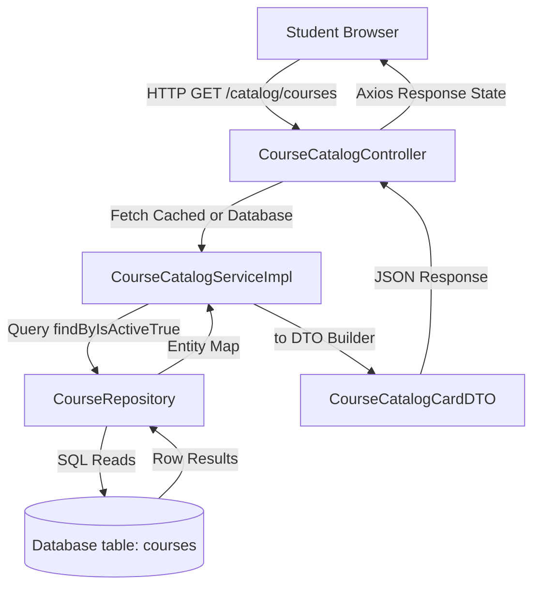
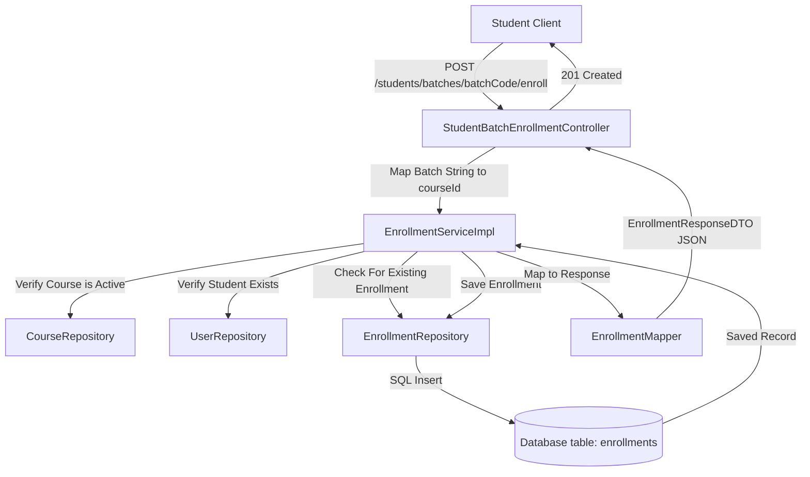
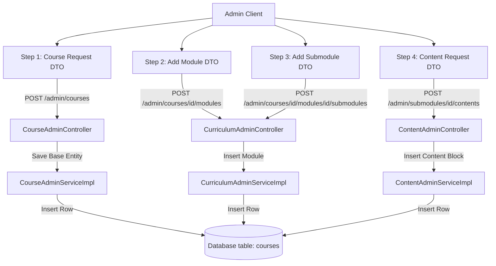

# Course Module Documentation

---

# Table of Contents

- [1. Module Overview](#1-module-overview)
  - [Purpose of the Course Module](#purpose-of-the-course-module)
  - [Business Goal](#business-goal)
  - [Supported User Roles](#supported-user-roles)
  - [High Level Architecture](#high-level-architecture)
  - [Dependencies on Other Modules](#dependencies-on-other-modules)
- [2. Roles & Features](#2-roles--features)
  - [Student Features](#student-features)
  - [Teacher Features](#teacher-features)
  - [Admin Features](#admin-features)
  - [Shared Features](#shared-features)
- [3. Complete Module Architecture](#3-complete-module-architecture)
- [4. Database Design](#4-database-design)
  - [Entity Relationship Details](#entity-relationship-details)
- [5. Complete File Structure](#5-complete-file-structure)
  - [Frontend Module Structure](#frontend-module-structure)
  - [Backend Package Structure](#backend-package-structure)
- [6. Feature Documentation](#6-feature-documentation)
  - [Feature 1: Course Catalog & Discovery](#feature-1-course-catalog--discovery)
  - [Feature 2: Student Enrollment (Self & Batch Mapping)](#feature-2-student-enrollment-self--batch-mapping)
  - [Feature 3: Curriculum Viewer & Interactive Slides](#feature-3-curriculum-viewer--interactive-slides)
  - [Feature 4: Admin Course Wizard Authoring](#feature-4-admin-course-wizard-authoring)
- [7. Module Flow](#7-module-flow)
- [8. API Reference](#8-api-reference)
- [9. Frontend Components Reference](#9-frontend-components-reference)
- [10. Backend Classes Reference](#10-backend-classes-reference)
- [11. Repository Methods](#11-repository-methods)
- [12. DTO Flow](#12-dto-flow)
- [13. Authentication & Authorization](#13-authentication--authorization)
- [14. Dependencies](#14-dependencies)
- [15. Performance Considerations](#15-performance-considerations)
- [16. Modification Guide](#16-modification-guide)
- [17. Troubleshooting](#17-troubleshooting)
- [18. Future Improvements](#18-future-improvements)
- [19. Summary](#19-summary)

---

# 1. Module Overview

### Purpose of the Course Module
The **Course Module** serves as the primary educational engine of the LMS platform. It provides a highly interactive and modular course delivery system, supporting custom nested curriculum hierarchies (Course → Modules → Submodules → Content Blocks) and comprehensive student enrollment and course-tracking services.

### Business Goal
To enable seamless digital knowledge sharing by providing administrators and course creators with intuitive, multi-step authoring tools to build rich curricula. At the same time, it provides students with a visually elegant learning portal where they can browse catalog items, register for specific cohorts/batches, access diverse educational slides, and log their progress.

### Supported User Roles
1. **Student (Learner)**: Searches, browses, and filters the course catalog. Enrolls in courses through manual clicks or by submitting cohort-specific batch codes, tracks progress, and views lesson slide-decks.
2. **Teacher (Instructor)**: Views rosters of enrolled students, monitors student-cohort status, and helps guide students within assigned courses/batches.
3. **Admin (LMS Operator)**: Full authoring permissions. Can create, edit, activate, or archive courses, construct nested modules and submodules, design rich lesson pages with code editors, video URLs, markdown callouts, or downloadable attachments, and manage high-level course categories.

### High Level Architecture
The Course Module uses a clean **Model-View-Controller (MVC) and Layered Service architecture**:
- **Frontend Layer**: Built in **React 18** with **Vite**, using **Tailwind CSS** for responsive designs, and **motion/react** for slide transitions and wizard step animations.
- **API Client**: Axios-based `apiClient` configured with interception for JWT bearer injection and structured error logging.
- **Backend Controller Layer**: Spring Boot `@RestController` annotations exposed under specific path groupings (`/admin/courses/**` for administrative CRUD, `/courses/**` and `/catalog/courses/**` for public permitted reads).
- **Service Layer**: Decoupled interface-driven business logic (`CourseAdminService`, `CourseCatalogService`, `EnrollmentService`, etc.) ensuring separation of transactional concerns.
- **Data Persistence Layer**: JPA Hibernate-based `JpaRepository` objects utilizing optimized SQL joins, split-fetch strategies, and transactional queries to talk to a relational PostgreSQL database.

### Dependencies on Other Modules
- **Authentication Module**: Extracts authenticated user context and roles (`ROLE_STUDENT`, `ROLE_TEACHER`, `ROLE_ADMIN`) via Spring Security for authorization checks.
- **User Module**: Bridges student entity profiles (`UserEntity`) with enrollment rosters.
- **Batch Module**: Connects batches and schedules (`BatchEntity`, `BatchStudentEntity`) to maps of registered courses.
- **Assignment Module**: Provides assessment units linked under specific submodules.

---

# 2. Roles & Features

## Student Features

### 1. View Course Catalog
- **Purpose**: Browse active, published courses grouped by relevant educational category.
- **Route**: `/courses`
- **Frontend Files**:
  - `/frontend/src/modules/courses/pages/CourseCatalogPage.tsx`
  - `/frontend/src/modules/courses/components/CourseCatalog.tsx`
  - `/frontend/src/modules/courses/components/CourseCard.tsx`
- **Backend Files**:
  - `/backend/src/main/java/com/geeknito/geeknito_backend/course/controller/CourseCatalogController.java`
  - `/backend/src/main/java/com/geeknito/geeknito_backend/course/service/CourseCatalogServiceImpl.java`
- **APIs Used**: `GET /catalog/courses/active` (or `GET /catalog/courses` for paginated variants)

### 2. Search & Filter Courses
- **Purpose**: Search courses by keywords or filter by category and difficulty levels.
- **Route**: `/courses`
- **Frontend Files**:
  - `/frontend/src/modules/courses/components/CourseCatalog.tsx`
- **Backend Files**:
  - `/backend/src/main/java/com/geeknito/geeknito_backend/category/controller/CategoryController.java`
  - `/backend/src/main/java/com/geeknito/geeknito_backend/course/repository/CourseRepository.java`
- **APIs Used**: `GET /categories`, `GET /catalog/courses/active`

### 3. View Course Curriculum Detail
- **Purpose**: Inspect a course's syllabus (modules, submodules) prior to or during learning.
- **Route**: `/courses/:slug`
- **Frontend Files**:
  - `/frontend/src/modules/courses/components/CourseDetailView.tsx`
- **Backend Files**:
  - `/backend/src/main/java/com/geeknito/geeknito_backend/course/controller/CourseCatalogController.java`
  - `/backend/src/main/java/com/geeknito/geeknito_backend/course/service/CourseCatalogServiceImpl.java`
- **APIs Used**: `GET /catalog/courses/{slug}`, `GET /courses/{courseId}/curriculum`

### 4. Enroll in a Course
- **Purpose**: Directly enroll in a published course.
- **Route**: `/courses/:slug` (Enrollment Modal Trigger)
- **Frontend Files**:
  - `/frontend/src/modules/courses/components/CourseDetailView.tsx`
  - `/frontend/src/services/enrollmentService.ts`
- **Backend Files**:
  - `/backend/src/main/java/com/geeknito/geeknito_backend/course/controller/EnrollmentController.java`
  - `/backend/src/main/java/com/geeknito/geeknito_backend/course/service/EnrollmentServiceImpl.java`
- **APIs Used**: `POST /enrollments` (payload: `{ courseId }`)

### 5. Enroll with Batch Code
- **Purpose**: Register for a course cohort by entering an instructor's batch code.
- **Route**: `/my-courses` (Code input prompt modal)
- **Frontend Files**:
  - `/frontend/src/modules/courses/pages/MyCourses.tsx`
  - `/frontend/src/modules/courses/components/BatchEnrollmentModal.tsx`
- **Backend Files**:
  - `/backend/src/main/java/com/geeknito/geeknito_backend/course/controller/StudentBatchEnrollmentController.java`
  - `/backend/src/main/java/com/geeknito/geeknito_backend/course/service/EnrollmentServiceImpl.java`
- **APIs Used**: `POST /students/batches/{batchId}/enroll`

### 6. Track Course Progress & View Slides
- **Purpose**: View interactive submodule slides (lessons) and track individual completions.
- **Route**: `/courses/:slug`
- **Frontend Files**:
  - `/frontend/src/modules/courses/components/CourseDetailView.tsx`
  - `/frontend/src/services/contentService.ts`
- **Backend Files**:
  - `/backend/src/main/java/com/geeknito/geeknito_backend/course/controller/CourseCatalogController.java`
  - `/backend/src/main/java/com/geeknito/geeknito_backend/course/service/ContentAdminServiceImpl.java`
- **APIs Used**: `GET /courses/submodules/{submoduleId}/contents`

---

## Teacher Features

### 1. View Assigned Course Rosters
- **Purpose**: Retrieve lists of eligible student profiles enrolled in their assigned course cohorts.
- **Route**: `/instructor/courses`
- **Frontend Files**:
  - `/frontend/src/services/enrollmentService.ts`
- **Backend Files**:
  - `/backend/src/main/java/com/geeknito/geeknito_backend/course/controller/EnrollmentController.java`
- **APIs Used**: `GET /enrollments/eligible-students` (params: `courseIds`)

---

## Admin Features

### 1. Create/Edit Courses with Multi-step Wizard
- **Purpose**: Interactive course authoring split into (Step 1: Details, Step 2: Modules, Step 3: Submodules, Step 4: Lessons & Content Blocks).
- **Route**: `/admin/courses/new` and `/admin/courses/:id/edit`
- **Frontend Files**:
  - `/frontend/src/modules/courses/components/CourseWizard/CourseWizardParent.tsx`
  - `/frontend/src/modules/courses/components/CourseWizard/WizardStep1.tsx`
  - `/frontend/src/modules/courses/components/CourseWizard/WizardStep2.tsx`
  - `/frontend/src/modules/courses/components/CourseWizard/WizardStep3.tsx`
  - `/frontend/src/modules/courses/components/CourseWizard/WizardStep4.tsx`
- **Backend Files**:
  - `/backend/src/main/java/com/geeknito/geeknito_backend/course/controller/CourseAdminController.java`
  - `/backend/src/main/java/com/geeknito/geeknito_backend/course/service/CourseAdminServiceImpl.java`
- **APIs Used**: `POST /admin/courses`, `PUT /admin/courses/{id}`, `GET /admin/courses/{id}`

### 2. Manage Category Metadata
- **Purpose**: Create and organize course taxonomy categories with unique labels, descriptions, and color highlights.
- **Route**: `/admin/categories`
- **Frontend Files**:
  - `/frontend/src/modules/courses/pages/CategoryManagement.tsx`
- **Backend Files**:
  - `/backend/src/main/java/com/geeknito/geeknito_backend/category/controller/CategoryAdminController.java`
  - `/backend/src/main/java/com/geeknito/geeknito_backend/category/service/CategoryAdminServiceImpl.java`
- **APIs Used**: `GET /categories`, `POST /categories`, `PUT /categories/{id}`, `DELETE /categories/{id}`

### 3. Build Curriculum (Modules & Submodules)
- **Purpose**: Organize a course with modules and nested submodules.
- **Route**: Course Wizard Step 2 & 3
- **Frontend Files**:
  - `/frontend/src/modules/courses/components/CourseWizard/WizardStep2.tsx`
  - `/frontend/src/modules/courses/components/CourseWizard/WizardStep3.tsx`
- **Backend Files**:
  - `/backend/src/main/java/com/geeknito/geeknito_backend/course/controller/CurriculumAdminController.java`
  - `/backend/src/main/java/com/geeknito/geeknito_backend/course/service/CurriculumAdminServiceImpl.java`
- **APIs Used**: `POST /admin/courses/{courseId}/modules`, `POST /admin/courses/{courseId}/modules/{moduleId}/submodules`

### 4. Create and Edit Content Blocks
- **Purpose**: Author specific lesson elements inside submodules (markdown files, text paragraphs, syntax-highlighted code editors, image links with alt captions, or video streams).
- **Route**: Course Wizard Step 4
- **Frontend Files**:
  - `/frontend/src/modules/courses/components/CourseWizard/blocks/*`
- **Backend Files**:
  - `/backend/src/main/java/com/geeknito/geeknito_backend/course/controller/ContentAdminController.java`
  - `/backend/src/main/java/com/geeknito/geeknito_backend/course/service/ContentAdminServiceImpl.java`
- **APIs Used**: `POST /admin/submodules/{submoduleId}/contents`, `PUT /admin/submodules/{submoduleId}/contents/{contentId}`

---

## Shared Features
- **Fetch Active Categories**: Both Students (for searching/filtering) and Admins (for assigning category tags during course creation) consume `/categories` endpoints.
- **Visual Sidebar Navigation**: Responsive access points in sidebar for both admin wizard modules and student catalog sections.

---

# 3. Complete Module Architecture

The following flow chart details how a client action progresses from the UI to the database and back in a full-stack cycle:

```
+------------------------------------------------------------+
|                       FRONTEND LAYER                       |
|  - React Components (CourseCatalog, CourseWizard, etc.)    |
|  - Component Local / Page-Level States                    |
+-----------------------------+------------------------------+
                              |
                              v [Uses Axios Client]
+------------------------------------------------------------+
|                         API CLIENT                         |
|  - apiClient.ts Interceptor (JWT Authorization Bearer)     |
|  - courseService.ts, enrollmentService.ts                  |
+-----------------------------+------------------------------+
                              |
                              v [HTTP Request JSON Payload]
+------------------------------------------------------------+
|                 CONTROLLERS (REST ENDPOINTS)               |
|  - CourseAdminController, CourseCatalogController          |
|  - EnrollmentController                                    |
+-----------------------------+------------------------------+
                              |
                              v [Resolves DTOs & Roles]
+------------------------------------------------------------+
|                        SERVICES LAYER                      |
|  - CourseAdminServiceImpl, CourseCatalogServiceImpl        |
|  - Decoupled transactions (@Transactional)                 |
+-----------------------------+------------------------------+
                              |
                              v [Entities & Queries]
+------------------------------------------------------------+
|                     REPOSITORIES (SPRING DATA)             |
|  - JpaRepository, Custom HQL & Native Queries              |
+-----------------------------+------------------------------+
                              |
                              v [SQL Operations]
+------------------------------------------------------------+
|                     RELATIONAL DATABASE                    |
|  - PostgreSQL Tables (courses, contents, enrollments, etc) |
+------------------------------------------------------------+
```

---

# 4. Database Design

The Course Module uses a normalized schema with constraints and indexes to optimize lookup times.

### Table Definitions

#### 1. Courses (`courses`)
Tracks the individual course profiles available in the catalog.
- **Columns**:
  - `id` (BIGSERIAL, PRIMARY KEY)
  - `title` (VARCHAR(255), NOT NULL)
  - `slug` (VARCHAR(255), NOT NULL, UNIQUE)
  - `thumbnail_url` (TEXT) - Fallback images provided
  - `short_description` (TEXT)
  - `description` (TEXT)
  - `level` (VARCHAR(255), NOT NULL) - Difficulty levels ("Beginner", etc.)
  - `duration` (VARCHAR(255))
  - `is_active` (BOOLEAN, DEFAULT TRUE, NOT NULL)
  - `category_id` (BIGINT, Foreign Key referencing `categories(id)`, ON DELETE SET NULL)
  - `created_at` (TIMESTAMP, DEFAULT CURRENT_TIMESTAMP, NOT NULL)
  - `updated_at` (TIMESTAMP)

#### 2. Categories (`categories`)
Groups courses by classification tags.
- **Columns**:
  - `id` (BIGSERIAL, PRIMARY KEY)
  - `name` (VARCHAR(255), NOT NULL, UNIQUE)
  - `icon` (VARCHAR(255)) - Lucide icon name string
  - `description` (TEXT)
  - `color` (VARCHAR(255)) - Tailwind CSS class representation
  - `is_active` (BOOLEAN, DEFAULT TRUE, NOT NULL)
  - `created_at` (TIMESTAMP, DEFAULT CURRENT_TIMESTAMP, NOT NULL)
  - `updated_at` (TIMESTAMP)

#### 3. Modules (`modules`)
Represents modular course headings/chapters.
- **Columns**:
  - `id` (BIGSERIAL, PRIMARY KEY)
  - `title` (VARCHAR(255), NOT NULL)
  - `description` (TEXT)
  - `module_order` (INTEGER, NOT NULL)
  - `is_active` (BOOLEAN, DEFAULT TRUE, NOT NULL)
  - `course_id` (BIGINT, NOT NULL, Foreign Key referencing `courses(id)`, ON DELETE CASCADE)
  - `created_at` (TIMESTAMP, DEFAULT CURRENT_TIMESTAMP, NOT NULL)
  - `updated_at` (TIMESTAMP)

#### 4. Submodules (`submodules`)
Provides granular lesson subcategories under modular chapters.
- **Columns**:
  - `id` (BIGSERIAL, PRIMARY KEY)
  - `title` (VARCHAR(255), NOT NULL)
  - `slug` (VARCHAR(255), NOT NULL)
  - `description` (TEXT)
  - `submodule_order` (INTEGER, NOT NULL)
  - `is_active` (BOOLEAN, DEFAULT TRUE, NOT NULL)
  - `module_id` (BIGINT, NOT NULL, Foreign Key referencing `modules(id)`, ON DELETE CASCADE)
  - `created_at` (TIMESTAMP, DEFAULT CURRENT_TIMESTAMP, NOT NULL)
  - `updated_at` (TIMESTAMP)

#### 5. Contents (`contents`)
Stores customized slide blocks forming lesson modules.
- **Columns**:
  - `id` (BIGSERIAL, PRIMARY KEY)
  - `title` (VARCHAR(255), NOT NULL)
  - `type` (VARCHAR(255), NOT NULL) - Enum strings ("text", "code", "video", "image", "file", "heading", "callout")
  - `text` (TEXT) - Markdown rich content
  - `code` (TEXT) - Code code snippet
  - `language` (VARCHAR(255)) - Code highlighter metadata
  - `video_url` (VARCHAR(255)) - Stream embed sources
  - `image_url` (VARCHAR(255)) - Embedded illustration links
  - `file_url` (VARCHAR(255)) - Downloadable file links
  - `file_name` (VARCHAR(255)) - Descriptive name for attachments
  - `alt` (VARCHAR(255)) - Image screen-reader descriptions
  - `caption` (VARCHAR(255)) - Image/Video labels
  - `heading_level` (INTEGER) - Hierarchy parameters
  - `content_order` (INTEGER, NOT NULL)
  - `is_active` (BOOLEAN, DEFAULT TRUE, NOT NULL)
  - `submodule_id` (BIGINT, NOT NULL, Foreign Key referencing `submodules(id)`, ON DELETE CASCADE)
  - `created_at` (TIMESTAMP, DEFAULT CURRENT_TIMESTAMP, NOT NULL)
  - `updated_at` (TIMESTAMP)

#### 6. Enrollments (`enrollments`)
Tracks student registrations.
- **Columns**:
  - `id` (BIGSERIAL, PRIMARY KEY)
  - `student_id` (BIGINT, NOT NULL, Foreign Key referencing `users(id)`, ON DELETE CASCADE)
  - `course_id` (BIGINT, NOT NULL, Foreign Key referencing `courses(id)`, ON DELETE CASCADE)
  - `status` (VARCHAR(50), NOT NULL) - Statuses ("ENROLLED", "ACTIVE", "COMPLETED", "DROPPED")
  - `progress_percentage` (INTEGER, DEFAULT 0, CHECK values 0 to 100)
  - `enrolled_at` (TIMESTAMP, DEFAULT CURRENT_TIMESTAMP, NOT NULL)
  - `last_accessed_at` (TIMESTAMP)
  - `completed_at` (TIMESTAMP)
- **Constraints**:
  - `uq_student_course` (UNIQUE (`student_id`, `course_id`)) - Prevents duplicate course mappings.

#### 7. Batches (`batches`)
Tracks instructional classroom cohort groups.
- **Columns**:
  - `id` (BIGSERIAL, PRIMARY KEY)
  - `name` (VARCHAR(255), NOT NULL)
  - `batch_code` (VARCHAR(100), NOT NULL, UNIQUE)
  - `course_id` (BIGINT, NOT NULL, Foreign Key referencing `courses(id)`, ON DELETE CASCADE)
  - `teacher_id` (BIGINT, NOT NULL, Foreign Key referencing `users(id)`, ON DELETE CASCADE)
  - `start_date` (TIMESTAMP)
  - `end_date` (TIMESTAMP)
  - `is_active` (BOOLEAN, DEFAULT TRUE, NOT NULL)
  - `created_at` (TIMESTAMP, DEFAULT CURRENT_TIMESTAMP, NOT NULL)
  - `updated_at` (TIMESTAMP)
- **Constraints**:
  - `uq_course_batch_name` (UNIQUE (`course_id`, `name`))

#### 8. Batch Students (`batch_students`)
Connects students to their batch cohort groups.
- **Columns**:
  - `id` (BIGSERIAL, PRIMARY KEY)
  - `batch_id` (BIGINT, NOT NULL, Foreign Key referencing `batches(id)`, ON DELETE CASCADE)
  - `student_id` (BIGINT, NOT NULL, Foreign Key referencing `users(id)`, ON DELETE CASCADE)
  - `status` (VARCHAR(50), DEFAULT 'ACTIVE', NOT NULL)
  - `enrolled_at` (TIMESTAMP, DEFAULT CURRENT_TIMESTAMP, NOT NULL)
- **Constraints**:
  - `uq_batch_student` (UNIQUE (`batch_id`, `student_id`))

---

### Entity Relationship Details
```
+---------------+        +------------------+        +-----------------+
|  CATEGORIES   |        |     COURSES      |        |     BATCHES     |
| - id (PK)     |<-------| - id (PK)        |<-------| - id (PK)       |
| - name (UQ)   |1      *| - category_id(FK)|1      *| - course_id(FK) |
+---------------+        +--------+---------+        | - teacher_id(FK)|
                                  |                  +--------+--------+
                                  |1                          |1
                                  |*                          |*
+---------------+        +--------v---------+        +--------v--------+
|  ENROLLMENTS  |        |     MODULES      |        | BATCH_STUDENTS  |
| - id (PK)     |        | - id (PK)        |        | - id (PK)       |
| - student_id  |        | - course_id (FK) |        | - batch_id (FK) |
| - course_id   |        +--------+---------+        | - student_id(FK)|
+---------------+                 |1                 +-----------------+
                                  |*
                         +--------v---------+
                         |   SUBMODULES     |
                         | - id (PK)        |
                         | - module_id (FK) |
                         +--------+---------+
                                  |1
                                  |*
                         +--------v---------+
                         |    CONTENTS      |
                         | - id (PK)        |
                         | - submodule_id(FK|
                         +------------------+
```

### Constraints, Keys & Foreign Key Triggers
1. **Cascade Deletes**:
   - Deleting a `course` cascades and deletes all associated `modules`, `submodules`, `contents`, and `batches`.
   - Deleting a `user` cascades and deletes all their associated `enrollments` and `batch_student` links.
2. **Nullable / Set Null Fields**:
   - Deleting a `category` sets the `category_id` column in the referencing `courses` rows to `NULL` (`ON DELETE SET NULL`), preventing catalog breaks.
3. **Database Level Check Constraints**:
   - `progress_percentage` column enforces an explicit boundary check `CHECK (progress_percentage >= 0 AND progress_percentage <= 100)`.

### Database Indexes for Fast Retrieval
To optimize search and navigation, index targets are created on lookup foreign keys and unique paths:
- `idx_courses_slug` ON `courses(slug)`
- `idx_courses_category` ON `courses(category_id)`
- `idx_modules_course` ON `modules(course_id)`
- `idx_submodules_module` ON `submodules(module_id)`
- `idx_contents_submodule` ON `contents(submodule_id)`
- `idx_enrollments_student` ON `enrollments(student_id)`
- `idx_enrollments_course` ON `enrollments(course_id)`
- `idx_batches_course` ON `batches(course_id)`
- `idx_batches_teacher` ON `batches(teacher_id)`
- `idx_batch_students_student` ON `batch_students(student_id)`

---

# 5. Complete File Structure

Here is the file structure representing only the Course Module inside the codebase.

### Frontend Module Structure
```
frontend/
└── src/
    ├── modules/
    │   └── courses/
    │       ├── components/
    │       │   ├── CourseWizard/
    │       │   │   ├── blocks/
    │       │   │   │   ├── CalloutBlockEditor.tsx
    │       │   │   │   ├── CodeBlockEditor.tsx
    │       │   │   │   ├── FileBlockEditor.tsx
    │       │   │   │   ├── HeadingBlockEditor.tsx
    │       │   │   │   ├── ImageBlockEditor.tsx
    │       │   │   │   ├── TextBlockEditor.tsx
    │       │   │   │   └── VideoBlockEditor.tsx
    │       │   │   ├── CourseWizardParent.tsx
    │       │   │   ├── WizardStep1.tsx
    │       │   │   ├── WizardStep2.tsx
    │       │   │   ├── WizardStep3.tsx
    │       │   │   └── WizardStep4.tsx
    │       │   ├── BatchEnrollmentModal.tsx
    │       │   ├── CourseCard.tsx
    │       │   ├── CourseCatalog.tsx
    │       │   ├── CourseCatalogView.tsx
    │       │   └── CourseDetailView.tsx
    │       └── pages/
    │           ├── CategoryManagement.tsx
    │           ├── CourseCatalogPage.tsx
    │           └── MyCourses.tsx
    ├── services/
    │   ├── categoryService.ts
    │   ├── contentService.ts
    │   ├── courseService.ts
    │   ├── curriculumService.ts
    │   └── enrollmentService.ts
    └── types/
        ├── category.ts
        └── course.ts
```

### Backend Package Structure
```
backend/
└── src/
    └── main/
        └── java/
            └── com/
                └── geeknito/
                    └── geeknito_backend/
                        ├── category/
                        │   ├── controller/
                        │   │   ├── CategoryAdminController.java
                        │   │   └── CategoryController.java
                        │   ├── dto/
                        │   │   └── CategoryDTO.java
                        │   ├── mapper/
                        │   │   └── CategoryMapper.java
                        │   ├── repository/
                        │   │   └── CategoryRepository.java
                        │   └── service/
                        │       ├── CategoryAdminService.java
                        │       ├── CategoryAdminServiceImpl.java
                        │       ├── CategoryService.java
                        │       └── CategoryServiceImpl.java
                        ├── course/
                        │   ├── controller/
                        │   │   ├── ContentAdminController.java
                        │   │   ├── CourseAdminController.java
                        │   │   ├── CourseCatalogController.java
                        │   │   ├── CurriculumAdminController.java
                        │   │   ├── EnrollmentController.java
                        │   │   └── StudentBatchEnrollmentController.java
                        │   ├── dto/
                        │   │   ├── ContentRequestDTO.java
                        │   │   ├── ContentResponseDTO.java
                        │   │   ├── CourseCatalogCardDTO.java
                        │   │   ├── CourseCatalogDetailDTO.java
                        │   │   ├── CourseRequestDTO.java
                        │   │   ├── CourseResponseDTO.java
                        │   │   ├── EligibleStudentResponseDTO.java
                        │   │   ├── EnrollmentRequestDTO.java
                        │   │   ├── EnrollmentResponseDTO.java
                        │   │   ├── ModuleRequestDTO.java
                        │   │   ├── ModuleResponseDTO.java
                        │   │   ├── SubmoduleRequestDTO.java
                        │   │   └── SubmoduleResponseDTO.java
                        │   ├── mapper/
                        │   │   ├── CourseMapper.java
                        │   │   └── EnrollmentMapper.java
                        │   ├── repository/
                        │   │   ├── ContentRepository.java
                        │   │   ├── CourseRepository.java
                        │   │   ├── EnrollmentRepository.java
                        │   │   ├── ModuleRepository.java
                        │   │   └── SubmoduleRepository.java
                        │   └── service/
                        │       ├── ContentAdminService.java
                        │       ├── ContentAdminServiceImpl.java
                        │       ├── CourseAdminService.java
                        │       ├── CourseAdminServiceImpl.java
                        │       ├── CourseCatalogService.java
                        │       ├── CourseCatalogServiceImpl.java
                        │       ├── CurriculumAdminService.java
                        │       ├── CurriculumAdminServiceImpl.java
                        │       ├── EnrollmentService.java
                        │       └── EnrollmentServiceImpl.java
                        └── entity/
                            └── learning/
                                ├── CategoryEntity.java
                                ├── ContentEntity.java
                                ├── CourseEntity.java
                                ├── EnrollmentEntity.java
                                ├── EnrollmentStatus.java
                                ├── ModuleEntity.java
                                └── SubmoduleEntity.java
```

---

# 6. Feature Documentation

## Feature 1: Course Catalog & Discovery

### Purpose
To let students explore active learning paths on the platform.

### User Role
- **Guest / Student**: Primary consumer.
- **Admin**: Views published status.

### Entry Point
- **Route**: `/courses`
- **Sidebar**: Clicking "Course Catalog" triggers navigation to `/courses`.
- **Button/Action**: Clicking on categories in the top bar filters the course catalog.

### User Flow
```
Student (Clicks Catalog)
       ↓
CourseCatalogPage.tsx (Mounts & triggers API fetch)
       ↓
courseService.ts (Invokes axios call)
       ↓
CourseCatalogController.java (Handles GET /catalog/courses)
       ↓
CourseCatalogServiceImpl.java (Applies Spring Caching rules & fetches entities)
       ↓
CourseRepository.java (Queries SQL table: SELECT * FROM courses WHERE is_active = true)
       ↓
DB Persistence (Returns rows mapped to Page<CourseEntity>)
       ↓
CourseCatalogCardDTO (Spring builder formats compact view parameters)
       ↓
CourseCatalogView (Renders CourseCard grid list with responsive layout details)
```

### Frontend Files
1. **`CourseCatalogPage.tsx`**:
   - **Purpose**: Page wrapper containing the catalog panel layout.
   - **Responsibilities**: Controls main section rendering, monitors user authorization roles, and formats page headers.
2. **`CourseCatalog.tsx`**:
   - **Purpose**: Main feature panel containing full search filters and layouts.
   - **Responsibilities**: Manages active category selection, handles real-time search queries, and triggers API fetches.
   - **Important Components**: Horizontal category tabs, keyword search bar, and CourseCard grids.
   - **Hooks**: `useState` for search text, `useEffect` for data-fetching.
   - **Calls**: `courseService.getAll()`, `categoryService.getAll()`.
3. **`CourseCard.tsx`**:
   - **Purpose**: Responsive visual card displaying course details.
   - **Responsibilities**: Displays thumbnail, titles, duration, category metadata, and level badges. Includes transition animations on hover.

### Backend Files
1. **`CourseCatalogController.java`**:
   - **Purpose**: Public REST handler.
   - **Responsibilities**: Receives `/catalog/courses` calls, parses pagination parameters (`page`, `size`, `sortBy`, `direction`), and returns serialized responses.
2. **`CourseCatalogServiceImpl.java`**:
   - **Purpose**: Learner catalog business engine.
   - **Responsibilities**: Performs transactional reads, handles cache lookups under `"course-catalog"`, and filters by active status.
3. **`CourseRepository.java`**:
   - **Purpose**: Core JPA database connector.
   - **Responsibilities**: Exposes `findByIsActiveTrue` pagination finders.

### API Details
- **Method**: `GET`
- **URL**: `/catalog/courses` (Parameters: `page`, `size`, `sortBy`, `direction`)
- **Authentication**: None required (`permitAll` matches in security rules).
- **Request Payload**: None.
- **Response Shape (200 OK JSON)**:
```json
{
  "content": [
    {
      "id": 1,
      "title": "Cybersecurity Essentials",
      "slug": "cybersecurity-essentials",
      "shortDescription": "Understand standard security practices...",
      "level": "Beginner",
      "duration": "6 Weeks"
    }
  ],
  "pageable": { ... },
  "totalElements": 1
}
```

### Database Flow
- **Tables Read**: `courses`, `categories`
- **Tables Written**: None (Pure query transaction)

### Sequence Diagram
```
Student             React Component            Axios API Client         Spring Controller            JPA Repository              Database
   │                       │                          │                        │                         │                      │
   │───Click Catalog──────>│                          │                        │                         │                      │
   │                       │───courseService.getAll()─>│                        │                         │                      │
   │                       │                          │───GET /catalog/courses─>│                         │                      │
   │                       │                          │                        │───findByIsActiveTrue()─>│                      │
   │                       │                          │                        │                         │───SQL SELECT────────>│
   │                       │                          │                        │                         |<───Row Results───────│
   │                       │                          │                        |<───Page<CourseEntity>───│                      │
   │                       │                          |<───HTTP JSON Response──│                         │                      │
   │                       |<───Update State (State)──│                        │                         │                      │
   │<───Render Cards───────│                          │                        │                         │                      │
```

### Mermaid Diagram


### Component Hierarchy
```
CourseCatalogPage
 └── CourseCatalog
      ├── SearchBar
      ├── CategoryFilterList
      └── GridContainer
           └── CourseCard (Iterated dynamically)
```

### State Management


### Validation


### Exception Handling


### Security


### 1. Method Flow
```
/frontend/src/modules/courses/components/CourseCatalog.tsx
Method:
useAuthenticatedQuery() -> loads course catalog data via courseService

↓

/frontend/src/services/courseService.ts
Method:
getAll(role)

↓

/backend/src/main/java/com/geeknito/geeknito_backend/course/controller/CourseCatalogController.java
Method:
getActiveCourses() (or getCatalogCourses() for paginated listings)

↓

/backend/src/main/java/com/geeknito/geeknito_backend/course/service/CourseCatalogServiceImpl.java
Method:
getActiveCourses() (or getCatalogCourses() for paginated listings)

↓

/backend/src/main/java/com/geeknito/geeknito_backend/course/repository/CourseRepository.java
Method:
findByIsActiveTrue() (or findByIsActiveTrue(Pageable pageable))
```

### 2. Request / Response Flow
```
Frontend State: userRole, filter criteria
       ↓
API Request: GET /api/v1/courses/active (or GET /catalog/courses?page=0&size=10&sortBy=id&direction=ASC)
       ↓
Controller: CourseCatalogController.getActiveCourses()
       ↓
Service: CourseCatalogServiceImpl.getActiveCourses()
       ↓
Repository: CourseRepository.findByIsActiveTrue()
       ↓
ORM Entity: List<CourseEntity> with eager/lazy-loaded CategoryEntity
       ↓
Mapper: Custom Spring Builder maps fields into CourseResponseDTO
       ↓
Response DTO: CourseResponseDTO (or CourseCatalogCardDTO)
       ↓
JSON Response: [ { "id": 1, "title": "...", "slug": "...", "shortDescription": "...", "level": "Beginner", "duration": "6 Weeks" } ]
       ↓
Frontend State: standardCoursesData (React Query Cache updates)
       ↓
Updated UI: Removes load skeleton and populates grid lists
```

### 3. Validation Flow
```
Permit All Filter: SecurityConfig matches public access pattern '/courses/active'
       ↓
Role Validation: None required (guest/anonymous read-only access)
       ↓
Request Parameter Parsing: Spring MVC maps request queries to pagination parameters
       ↓
Sorting Validation: Verifies sorting key maps to a valid field and direction is 'ASC' or 'DESC'
       ↓
Business Constraint Check: Asserts fetched courses are active (isActive == true)
       ↓
Database read-only session isolation check
```

### 4. Authentication & Authorization Flow
- **Authentication**: Optional. Interceptors attach Bearer JWT if available, but GUEST role is matched if missing.
- **Authorization**: Checked via Spring Security configuration properties.
  - Public routes permitted: `/courses/**`, `/catalog/courses/**`
- **Role Permissions Table**:
  | Role | Access Granted | Context / Rules |
  | :--- | :--- | :--- |
  | `ANONYMOUS` / `GUEST` | Yes | Pure read-only view access |
  | `STUDENT` | Yes | Read-only view access |
  | `TEACHER` | Yes | Read-only view access |
  | `ADMIN` | Yes | Admin view routes directly to administrative editors |

### 5. Database Flow
- **Entity**: `CourseEntity` (Many-to-One association to `CategoryEntity`)
- **Repository**: `CourseRepository`
- **Tables Read**: `courses`, `categories`
- **Tables Written**: None (ReadOnly transactional query)
- **Database Schema Mappings**:
  - `courses` table: `id` (PK), `title`, `slug`, `short_description`, `thumbnail_url`, `level`, `duration`, `is_active`, `category_id` (FK)
  - `categories` table: `id` (PK), `name`, `is_active`
- **Indexes Utilized**:
  - `idx_courses_slug` (Unique index on slug parameters)
  - `idx_courses_active` (Composite index on course active status and category id)

### 6. Repository Methods
| Method Name | Purpose | Query Type |
| :--- | :--- | :--- |
| `findByIsActiveTrue(Pageable pageable)` | Resolves paginated collections of published courses. | Spring Data JPA Derived Query |
| `findByIsActiveTrue()` | Resolves raw lists of all active, published courses. | Spring Data JPA Derived Query |

### 7. Frontend State Flow
```
Component Mount: CourseCatalogPage layout initiates
       ↓
Hook Trigger: useAuthenticatedQuery activates on component load
       ↓
API Dispatch: Triggers courseService.getAll(userRole)
       ↓
Axios Request: Sends GET /courses/active to backend
       ↓
setState: react-query Cache updates, updating local state variables standardCoursesData
       ↓
Component Re-render: CourseCatalog receives catalog details and filters skeletons
       ↓
Updated UI: Horizontal category badges and visual course cards populate the grid
```

### 8. Component Hierarchy
```
CourseCatalogPage
 └── CourseCatalog
      ├── SearchBar
      ├── CategoryFilterList
      └── GridContainer
           └── CourseCard (Iterated dynamically)
```

### 9. Error Handling Flow
- **Database Down**: `DataAccessResourceFailureException` is caught globally.
- **Global Error Handler**: Generates standardized `ErrorResponse` layout containing a 500 status code.
- **Axios Interceptor**: Catches the HTTP 500 rejection error and logs a console warning.
- **Fallback Data**: Falls back to loading default mock presets in `enrollmentService.ts` to keep user interactive.
- **Toast Notice**: Dispatches `showToast("Failed to fetch course catalog. Displaying offline mode.", "error")` to notify the student.

### 10. Complete Dependency Table
| Layer | Root File Path | Methods | Called By | Calls Next | Responsibility |
| :--- | :--- | :--- | :--- | :--- | :--- |
| Route | `/frontend/src/App.tsx` | - | Browser | `CourseCatalogPage.tsx` | Dynamic paths registration |
| Page | `/frontend/src/modules/courses/pages/CourseCatalogPage.tsx` | `render()` | `App.tsx` | `CourseCatalog.tsx` | Layout container for the catalog grid |
| Component | `/frontend/src/modules/courses/components/CourseCatalog.tsx` | `render()`, `useMemo()` | `CourseCatalogPage.tsx` | `courseService.ts`, `CourseCard.tsx` | Manages query state, filters, and layouts |
| Component | `/frontend/src/modules/courses/components/CourseCard.tsx` | `render()` | `CourseCatalog.tsx` | - | Responsive preview card with transition animations |
| Service | `/frontend/src/services/courseService.ts` | `getAll()` | `CourseCatalog.tsx` | `apiClient.ts` | Formulates endpoints routing paths based on role |
| API client | `/frontend/src/lib/apiClient.ts` | `get()` | `courseService.ts` | Spring Boot API | Sets axios defaults and authorization headers |
| Controller | `/backend/src/main/java/com/geeknito/geeknito_backend/course/controller/CourseCatalogController.java` | `getActiveCourses()` / `getCatalogCourses()` | DispatcherServlet | `CourseCatalogServiceImpl.java` | Entrypoint router parsing query bounds |
| Service | `/backend/src/main/java/com/geeknito/geeknito_backend/course/service/CourseCatalogServiceImpl.java` | `getActiveCourses()` | `CourseCatalogController.java` | `CourseRepository.java` | Handles redis cache, calls repository |
| Repository | `/backend/src/main/java/com/geeknito/geeknito_backend/course/repository/CourseRepository.java` | `findByIsActiveTrue()` | `CourseCatalogServiceImpl.java` | Database | Exposes course catalog SQL queries |
| Entity | `/backend/src/main/java/com/geeknito/geeknito_backend/entity/learning/CourseEntity.java` | - | `CourseRepository.java` | `CategoryEntity.java` | Mapped database table metadata definitions |

### Performance Notes
- **Spring @Cacheable**: Database query results are cached under `"course-catalog"` key parameters. Changes to courses evict this cache.
- **Lightweight DTOs**: Avoids loading full text blobs or submodule entities during discovery.

---

## Feature 2: Student Enrollment (Self & Batch Mapping)

### Purpose
To let students self-enroll in published courses, or map themselves to a cohort using a shared batch code.

### User Role
- **Student**: Primary applicant.

### Entry Point
- **Route**: `/courses/:slug` (Enrollment Modal button) or `/my-courses` (Code modal input).
- **Action**: Click "Enroll Now" or enter a code and click "Submit Code".

### User Flow
```
Student (Clicks Enroll)
       ↓
CourseDetailView.tsx (Triggers enrollmentService.enroll)
       ↓
EnrollmentController.java (Intercepts POST /enrollments)
       ↓
EnrollmentServiceImpl.java (Validates conditions)
       ↓
EnrollmentRepository.java (Creates and saves EnrollmentEntity)
       ↓
DB Table: enrollments (Inserts row with status: ENROLLED, progress: 0)
       ↓
EnrollmentMapper.java (Returns EnrollmentResponseDTO)
```

### Frontend Files
1. **`CourseDetailView.tsx`**:
   - **Purpose**: Interactive viewport for course syllabi.
   - **Responsibilities**: Displays enrollment actions depending on student status.
2. **`MyCourses.tsx`**:
   - **Purpose**: Lists enrolled courses and displays the "Join Batch" option.
3. **`BatchEnrollmentModal.tsx`**:
   - **Purpose**: Input modal for cohort-joining operations.
   - **Calls**: `enrollmentService.enroll(batchId)`.

### Backend Files
1. **`EnrollmentController.java`**:
   - **Purpose**: Enrollment entry point.
   - **Responsibilities**: Enrolls students via `/enrollments` or `/students/batches/{batchId}/enroll`.
2. **`EnrollmentServiceImpl.java`**:
   - **Purpose**: Transaction engine.
   - **Responsibilities**: Verifies if user/course exists, confirms course and category are active, validates unique constraints (can't enroll twice), and persists the registration.
3. **`StudentBatchEnrollmentController.java`**:
   - **Purpose**: Cohort registry.
   - **Responsibilities**: Receives batch-code commands, maps codes to courses, and registers students.

### API Details
- **Method**: `POST`
- **URL**: `/enrollments`
- **Request Payload**:
```json
{
  "courseId": 3
}
```
- **Response Shape (201 Created JSON)**:
```json
{
  "id": 15,
  "studentId": 2,
  "courseId": 3,
  "status": "ENROLLED",
  "progressPercentage": 0,
  "enrolledAt": "2026-07-16T11:15:00Z"
}
```

---

### Database Flow
- **Tables Read**: `users`, `courses`, `categories`, `batches` (in batch-enroll cases).
- **Tables Written**: `enrollments`, `batch_students` (in batch-enroll cases).

### Sequence Diagram
```
Student              EnrollmentModal            Spring Controller          EnrollmentService            JPA Repository             Database
   │                        │                           │                          │                           │                       │
   │───Submit batchId──────>│                           │                          │                           │                       │
   │                        │───POST /batches/{id}/en──>│                          │                           │                       │
   │                        │                           │───enrollStudent()───────>│                           │                       │
   │                        │                           │                          │───existsByStudentAnd...──>│                       │
   │                        │                           │                          │<───false (not enrolled)───│                       │
   │                        │                           │                          │                           │                       │
   │                        │                           │                          │───save(enrollment)───────>│                       │
   │                        │                           │                          │                           │───SQL INSERT─────────>│
   │                        │                           │                          │                           |<───Success ID─────────│
   │                        │                           |<───EnrollmentEntity──────│                           │                       │
   │                        |<───JSON Response (201)────│                          │                           │                       │
   │<───Display "Joined"────│                           │                          │                           │                       │
```

### Mermaid Diagram


### 1. Method Flow
```
/frontend/src/modules/courses/components/BatchEnrollmentModal.tsx
Method:
onSubmit() -> triggers enrollmentService.enrollInBatch

↓

/frontend/src/services/enrollmentService.ts
Method:
enrollInBatch(batchCode)

↓

/backend/src/main/java/com/geeknito/geeknito_backend/course/controller/StudentBatchEnrollmentController.java
Method:
enrollInBatch(batchCode)

↓

/backend/src/main/java/com/geeknito/geeknito_backend/course/service/EnrollmentServiceImpl.java
Method:
enrollInBatch(batchCode, userId)

↓

/backend/src/main/java/com/geeknito/geeknito_backend/course/repository/EnrollmentRepository.java
Method:
existsByStudentIdAndCourseId() -> and then save()
```

### 2. Request / Response Flow
```
Frontend State: batchCode input, isSubmitting: true
       ↓
API Request: POST /api/v1/students/batches/enroll (with payload: { "batchCode": "X7Y2Z" })
       ↓
Controller: StudentBatchEnrollmentController.enrollInBatch()
       ↓
Service: EnrollmentServiceImpl.enrollInBatch()
       ↓
Repository checks: Confirms user exists, batch exists, course is active, enrollment does not already exist
       ↓
ORM Entity creation: EnrollmentEntity with status ENROLLED, progress 0
       ↓
Mapper: Maps EnrollmentEntity to EnrollmentResponseDTO
       ↓
Response DTO: EnrollmentResponseDTO
       ↓
JSON Response: { "id": 45, "studentId": 12, "courseId": 2, "status": "ENROLLED" }
       ↓
Frontend State: showEnrollmentSuccess: true, isSubmitting: false
       ↓
Updated UI: Closes modal and displays success banner alert
```

### 3. Validation Flow
```
Bearer Token Validation: Extracts and validates JWT claims via JwtAuthenticationFilter
       ↓
Role Validation: Requires STUDENT, TEACHER, or ADMIN role privileges
       ↓
Request Parameter Validation: Ensures batchCode matches structural regex constraints (e.g., non-empty, 5-10 chars)
       ↓
Business Rule Validation: Confirms batch registration window is open, course exists, and is published
       ↓
Duplicate Validation: existsByStudentIdAndCourseId() throws PreconditionFailedException if user is already enrolled
       ↓
Database unique constraint validation
```

### 4. Authentication & Authorization Flow
- **Authentication**: Mandatory. Incoming requests must contain a valid Authorization: Bearer JWT header.
- **Authorization**: Configured in Spring Security.
  - Endpoints `/api/v1/students/**` require role authentication.
- **Role Permissions Table**:
  | Role | Access Granted | Context / Rules |
  | :--- | :--- | :--- |
  | `GUEST` / `ANONYMOUS` | No | Retruns `401 Unauthorized` |
  | `STUDENT` | Yes | Can self-enroll or batch-enroll into courses |
  | `TEACHER` | Yes | View-only permissions on student side |
  | `ADMIN` | Yes | Full administrative permissions over student profiles |

### 5. Database Flow
- **Entities**: `EnrollmentEntity`, `BatchEntity`, `UserEntity`, `CourseEntity`
- **Repository**: `EnrollmentRepository`, `BatchRepository`, `UserRepository`
- **Tables Read**: `users`, `batches`, `courses`, `enrollments`
- **Tables Written**: `enrollments` (New row inserted on success)
- **Database Schema Mappings**:
  - `enrollments` table: `id` (PK), `student_id` (FK), `course_id` (FK), `status`, `progress_percentage`, `enrolled_at`, `completed_at`
  - `batches` table: `id` (PK), `batch_code` (Unique Index), `course_id` (FK), `max_students`, `is_active`
- **Indexes Utilized**:
  - `idx_enrollments_student_course` (Unique composite index on student_id and course_id)
  - `idx_batches_code` (Unique index lookup on batch_code)

### 6. Repository Methods
| Method Name | Purpose | Query Type |
| :--- | :--- | :--- |
| `existsByStudentIdAndCourseId(Long studentId, Long courseId)` | Prevents duplicate enrollments in the same course. | Spring Data JPA Derived Query |
| `findByStudentId(Long studentId)` | Lists all current course enrollments for a student. | Spring Data JPA Derived Query |
| `save(EnrollmentEntity entity)` | Persists a new enrollment record or updates progress. | Spring Data JPA Default Save |

### 7. Frontend State Flow
```
User Event: Student enters code and clicks "Submit" in BatchEnrollmentModal
       ↓
Hook Dispatch: useMutation triggers api call to enrollmentService.enrollInBatch
       ↓
Axios Dispatch: Sends HTTP POST with payload containing batchCode
       ↓
State Updates: Sets isSubmitting: true to disable input controls and show spinner
       ↓
HTTP Success: Receives 201 Created containing enrollment details
       ↓
Cache Invalidation: Invalidates 'my-courses' and 'enrolled-courses' React Query tags
       ↓
State Updates: Sets showEnrollmentSuccess: true and isSubmitting: false
       ↓
UI Transition: Modal closes, triggers sliding fade animation, updates course lists
```

### 8. Component Hierarchy
```
App.tsx
 └── ProtectedRoute (Logged-In Student)
      └── MyCoursesPage (Main view layout)
           ├── MyCoursesHeader (Contains "Join Batch" button trigger)
           ├── EnrolledCourseGrid (Iterates active enrollment list)
           └── BatchEnrollmentModal (Triggered by state toggle)
                └── ModalCard (Input wrapper, form submission, close action)
```

### 9. Error Handling Flow
- **Course Inactive**: Throws `CourseInactiveException` (Mapped to 400 Bad Request with "Course is currently unavailable").
- **Batch Code Invalid**: Throws `EntityNotFoundException` (Mapped to 404 Not Found with "Invalid or expired batch code").
- **Duplicate Registration**: Throws `DuplicateEnrollmentException` (Mapped to 409 Conflict with "You are already enrolled in this course").
- **Constraint Violations**: Triggers `@ControllerAdvice` global handler formatting custom error JSON.
- **Frontend Fallback**: Form validation catches blank codes early; Axios catch handler fires toast: `showToast(error.response?.data?.message || "Enrollment failed", "error")`.

### 10. Complete Dependency Table
| Layer | Root File Path | Methods | Called By | Calls Next | Responsibility |
| :--- | :--- | :--- | :--- | :--- | :--- |
| Route | `/frontend/src/App.tsx` | - | Browser | `MyCourses.tsx` | Paths mapping for user dashboards |
| Page | `/frontend/src/modules/courses/pages/MyCourses.tsx` | `render()` | `App.tsx` | `BatchEnrollmentModal.tsx` | Lists student courses, handles modal toggles |
| Component | `/frontend/src/modules/courses/components/BatchEnrollmentModal.tsx` | `handleSubmit()`, `render()` | `MyCourses.tsx` | `enrollmentService.ts` | Displays batch entry popup, tracks field validation |
| Service | `/frontend/src/services/enrollmentService.ts` | `enrollInBatch()`, `selfEnroll()` | `BatchEnrollmentModal.tsx` | `apiClient.ts` | Sends enrollment requests to backend endpoints |
| API client | `/frontend/src/lib/apiClient.ts` | `post()` | `enrollmentService.ts` | Spring Boot API | Sets authorization Bearer headers |
| Controller | `/backend/src/main/java/com/geeknito/geeknito_backend/course/controller/StudentBatchEnrollmentController.java` | `enrollInBatch()` | DispatcherServlet | `EnrollmentServiceImpl.java` | Directs incoming enrollment payloads |
| Service | `/backend/src/main/java/com/geeknito/geeknito_backend/course/service/EnrollmentServiceImpl.java` | `enrollInBatch()` | `StudentBatchEnrollmentController.java` | `EnrollmentRepository.java` | Implements user validation and enrollment rules |
| Repository | `/backend/src/main/java/com/geeknito/geeknito_backend/course/repository/EnrollmentRepository.java` | `existsByStudentIdAndCourseId()` | `EnrollmentServiceImpl.java` | Database | Executes JPA duplicate and save commands |
| Entity | `/backend/src/main/java/com/geeknito/geeknito_backend/entity/learning/EnrollmentEntity.java` | - | `EnrollmentRepository.java` | - | Student registration schema definitions |

### Performance Notes
- **Composite Indexing**: Employs `idx_enrollments_student_course` unique composite index on the database to prevent write-level race conditions.
- **Selective Fetching**: Queries rely on shallow enrollment mappings, lazy-loading bulky module tables until the student begins curriculum study.

---

## Feature 3: Curriculum Viewer & Interactive Slides

### Purpose
To let enrolled students access lesson materials (modules, submodules, content blocks) in an interactive slider view.

### User Role
- **Enrolled Student**: Primary consumer.

### Entry Point
- **Route**: `/courses/:slug` (Learning panel trigger).
- **Button**: Clicking "Continue Learning" or choosing a submodule from the syllabus tree opens the viewer.

### User Flow
```
Student (Clicks Submodule Slide)
       ↓
CourseDetailView.tsx (Loads submodule state)
       ↓
contentService.ts (Invokes getPublicContentBySubmodule)
       ↓
CourseCatalogController.java (Handles GET /courses/submodules/{submoduleId}/contents)
       ↓
ContentAdminServiceImpl.java (Queries DB & maps to Response DTO)
       ↓
ContentRepository.java (Fetches and orders active content blocks)
       ↓
CourseDetailView (Renders sliding slide-deck framed by motion animations)
```

### Frontend Files
1. **`CourseDetailView.tsx`**:
   - **Purpose**: Serves as the primary content hub for the learner.
   - **Responsibilities**: Fetches public course structures, renders module/submodule accordions, and loads lesson slides.
   - **Important Components**:
     - Accordion syllabus tree.
     - Interactive lesson slider container with navigation buttons.
     - Progress ring indicator reflecting completion percentage.
   - **Hooks**: `useState` for slide index and selected submodule, `useEffect` for slide data loading.
   - **Calls**: `curriculumService.getPublicCourseCurriculum()`, `contentService.getPublicContentBySubmodule()`.

### Backend Files
1. **`CourseCatalogController.java`**:
   - **Purpose**: Public endpoints router.
   - **Responsibilities**: Connects endpoints `/courses/{courseId}/curriculum` and `/courses/submodules/{submoduleId}/contents` to non-admin calls. This avoids 403 Forbidden checks for students.
2. **`ContentAdminServiceImpl.java`**:
   - **Purpose**: Content retrieval controller.
   - **Responsibilities**: Queries active records ordered by `contentOrder`.
3. **`ContentRepository.java`**:
   - **Purpose**: Data mapper.
   - **Responsibilities**: Standard queries (`findBySubmoduleIdAndIsActiveTrueOrderByContentOrderAsc`).

### API Details
- **Method**: `GET`
- **URL**: `/courses/submodules/{submoduleId}/contents`
- **Authentication**: Bearer JWT.
- **Response Shape (200 OK JSON)**:
```json
[
  {
    "id": 42,
    "title": "Module Overview",
    "type": "text",
    "text": "### Getting Started\nWelcome to this course module...",
    "contentOrder": 1,
    "isActive": true
  },
  {
    "id": 43,
    "title": "Code Sample",
    "type": "code",
    "code": "System.out.println(\"Hello World\");",
    "language": "java",
    "contentOrder": 2,
    "isActive": true
  }
]
```

### Database Flow
- **Tables Read**: `modules`, `submodules`, `contents`
- **Tables Written**: None (Pure reads)

### Component Hierarchy
```
CourseDetailView
 ├── SidebarCurriculumAccordion (Navigation Syllabus)
 └── ActiveLessonSlideContainer
      ├── SlideHeader (Progress Tracking & Lesson title)
      └── StaggeredSlideViewport
           ├── TextBlockRenderer
           ├── CodeHighlightBox
           └── ImageAttachmentBox
```

### 1. Method Flow
```
/frontend/src/modules/courses/pages/CourseDetailPage.tsx
Method:
render() -> mounts CourseDetailView

↓

/frontend/src/modules/courses/components/CourseDetailView.tsx
Method:
useEffect() -> calls curriculumService.getPublicCourseCurriculum and then contentService.getPublicContentBySubmodule

↓

/frontend/src/services/contentService.ts
Method:
getPublicContentBySubmodule(submoduleId)

↓

/backend/src/main/java/com/geeknito/geeknito_backend/course/controller/CourseCatalogController.java
Method:
getPublicSubmoduleContents(submoduleId)

↓

/backend/src/main/java/com/geeknito/geeknito_backend/course/service/ContentAdminServiceImpl.java (utilized for public read routing)
Method:
getActiveContentsBySubmodule(submoduleId)

↓

/backend/src/main/java/com/geeknito/geeknito_backend/course/repository/ContentRepository.java
Method:
findBySubmoduleIdAndIsActiveTrueOrderByContentOrderAsc(submoduleId)
```

### 2. Request / Response Flow
```
Frontend State: activeSubmodule: 8, currentSlideIndex: 0
       ↓
API Request: GET /api/v1/catalog/submodules/8/contents (or GET /courses/submodules/8/contents)
       ↓
Controller: CourseCatalogController.getPublicSubmoduleContents()
       ↓
Service: ContentAdminServiceImpl.getActiveContentsBySubmodule()
       ↓
Repository: ContentRepository.findBySubmoduleIdAndIsActiveTrueOrderByContentOrderAsc()
       ↓
ORM Entity: List<ContentEntity> ordered by column content_order
       ↓
Mapper: Maps list elements to ContentResponseDTO objects
       ↓
JSON Response: [ { "id": 42, "title": "Overview", "type": "text", "text": "...", "contentOrder": 1 } ]
       ↓
Frontend State: contents state array loaded, currentSlideIndex initialized to 0
       ↓
Updated UI: Staggered slider renders the text blocks, code boxes, and interactive navigation controls
```

### 3. Validation Flow
```
Authorization Header: Reads JWT token claims
       ↓
Scope Verification: Confirms student has a valid enrollment record for the parent course
       ↓
Input Parameter Validation: Asserts submoduleId parameter is a valid non-null numeric ID
       ↓
Business Constraint Check: Confirms the submodule and content blocks have isActive == true
       ↓
Sorting Validation: Orders the collection strictly by content_order ASC on the database session
```

### 4. Authentication & Authorization Flow
- **Authentication**: Optional for public overview but Mandatory for slide viewing. Standard Authorization JWT required.
- **Authorization**: Configured in Spring Security rules.
  - Endpoints under `/catalog/**` and public course routes are open to GUEST, but specific content block lists are gated behind active student enrollment.
- **Role Permissions Table**:
  | Role | Access Granted | Context / Rules |
  | :--- | :--- | :--- |
  | `GUEST` / `ANONYMOUS` | Yes | Limited to public course syllabus structure |
  | `STUDENT` | Yes | Enrolled students have full access to submodule slide decks |
  | `TEACHER` | Yes | Can view and audit all course content blocks |
  | `ADMIN` | Yes | Administrative edit/view authorization over all contents |

### 5. Database Flow
- **Entities**: `ModuleEntity`, `SubmoduleEntity`, `ContentEntity`
- **Repository**: `ModuleRepository`, `SubmoduleRepository`, `ContentRepository`
- **Tables Read**: `modules`, `submodules`, `contents`
- **Tables Written**: None (ReadOnly transactional query)
- **Database Schema Mappings**:
  - `modules` table: `id` (PK), `title`, `module_order`, `course_id` (FK), `is_active`
  - `submodules` table: `id` (PK), `title`, `submodule_order`, `module_id` (FK), `is_active`
  - `contents` table: `id` (PK), `title`, `type`, `text_content`, `code_content`, `language`, `image_url`, `content_order`, `submodule_id` (FK), `is_active`
- **Indexes Utilized**:
  - `idx_contents_submodule` (Index mapping submodule_id references)
  - `idx_submodules_module` (Index mapping module_id references)

### 6. Repository Methods
| Method Name | Purpose | Query Type |
| :--- | :--- | :--- |
| `findBySubmoduleIdAndIsActiveTrueOrderByContentOrderAsc(Long submoduleId)` | Fetches ordered list of content blocks for student viewer. | Spring Data JPA Derived Query |
| `findByModuleIdAndIsActiveTrueOrderBySubmoduleOrderAsc(Long moduleId)` | Retrieves the submodules belonging to a course module. | Spring Data JPA Derived Query |

### 7. Frontend State Flow
```
User Navigation: Student clicks on a submodule node in the syllabus accordion tree
       ↓
State Transition: Updates activeSubmodule state pointer to the clicked node ID
       ↓
Query Execution: Triggers react-query hook, initiating getPublicContentBySubmodule(activeSubmodule)
       ↓
Axios Payload: Sends HTTP GET request with Authorization bearer token
       ↓
Data Received: Populates local React state array contents
       ↓
Slider Reset: Re-initializes currentSlideIndex pointer to 0
       ↓
Component Re-render: ActiveLessonSlideContainer rebuilds, triggering entry fade-in animations
       ↓
UI Update: Slider updates controls enabling next/prev buttons and the progress ring
```

### 8. Component Hierarchy
```
App.tsx
 └── ProtectedRoute (Logged-In Student)
      └── CourseDetailPage (Page frame layout)
           └── CourseDetailView (Interactive coordinator panel)
                ├── SidebarSyllabusAccordion (Lists modules and submodules)
                └── ActiveLessonSlideContainer (Main slide player window)
                     ├── ProgressBarIndicator (Renders the slide progress percentage)
                     └── StaggeredSlideViewport (Displays active content element)
                          ├── TextBlockRenderer (Renders markdown text)
                          ├── CodeHighlightBox (Prints formatted code blocks)
                          └── ImageAttachmentBox (Renders associated media)
```

### 9. Error Handling Flow
- **Resource Not Found**: If submoduleId does not exist, backend returns `404 Not Found`.
- **Enrollment Missing**: Returns `403 Forbidden` if student is not registered in the parent course.
- **Empty Slide Deck**: Handled gracefully by the frontend rendering a fallback "No slides available for this topic yet" state.
- **Frontend Fallbacks**: Axios interceptor displays error toasts; code-highlighting falls back to plain-text rendering if syntax-highlighting libraries crash on bad formatting.

### 10. Complete Dependency Table
| Layer | Root File Path | Methods | Called By | Calls Next | Responsibility |
| :--- | :--- | :--- | :--- | :--- | :--- |
| Route | `/frontend/src/App.tsx` | - | Browser | `CourseDetailPage.tsx` | Front-end URL routes registry |
| Page | `/frontend/src/modules/courses/pages/CourseDetailPage.tsx` | `render()` | `App.tsx` | `CourseDetailView.tsx` | Layout container matching course slug routes |
| Component | `/frontend/src/modules/courses/components/CourseDetailView.tsx` | `render()`, `handleNext()`, `handlePrev()` | `CourseDetailPage.tsx` | `contentService.ts`, `curriculumService.ts` | Controls lesson slide indices, progress, and accordions |
| Service | `/frontend/src/services/contentService.ts` | `getPublicContentBySubmodule()` | `CourseDetailView.tsx` | `apiClient.ts` | Formulates submodule slide API routing endpoints |
| Service | `/frontend/src/services/curriculumService.ts` | `getPublicCourseCurriculum()` | `CourseDetailView.tsx` | `apiClient.ts` | Downloads the course modules/submodules syllabus tree |
| Controller | `/backend/src/main/java/com/geeknito/geeknito_backend/course/controller/CourseCatalogController.java` | `getPublicSubmoduleContents()`, `getPublicCourseCurriculum()` | DispatcherServlet | `ContentAdminServiceImpl.java`, `CurriculumAdminServiceImpl.java` | Maps learner curriculum endpoints without administrative role guards |
| Service | `/backend/src/main/java/com/geeknito/geeknito_backend/course/service/ContentAdminServiceImpl.java` | `getActiveContentsBySubmodule()` | `CourseCatalogController.java` | `ContentRepository.java` | Content coordinator query logic |
| Repository | `/backend/src/main/java/com/geeknito/geeknito_backend/course/repository/ContentRepository.java` | `findBySubmoduleIdAndIsActiveTrueOrderByContentOrderAsc()` | `ContentAdminServiceImpl.java` | Database | Exposes SQL selects ordered by slide order |
| Entity | `/backend/src/main/java/com/geeknito/geeknito_backend/entity/learning/ContentEntity.java` | - | `ContentRepository.java` | - | Declares properties matching content table columns |

### Performance Notes
- **Split-Fetch Performance**: Submodule slide fetches are decoupled from general curriculum structure queries. This prevents heavy database loads and eliminates `MultipleBagFetchException` errors.
- **Ordering Index**: Uses composite table indexing on `submodule_id` and `content_order` to maximize read speed.

---

## Feature 4: Admin Course Wizard Authoring

### Purpose
To let administrators author courses, categories, syllabi, and content blocks in a structured, multi-step flow.

### User Role
- **Admin**: Primary creator.

### Entry Point
- **Route**: `/admin/courses/new` or `/admin/courses/:id/edit`
- **Action**: Clicking "Create Course" in the admin dashboard opens the wizard.

### User Flow
```
Admin (Enters Wizard UI)
       ↓
CourseWizardParent.tsx (Coordinates layout steps)
       ↓
WizardStep1.tsx (Creates course base details via POST /admin/courses)
       ↓
WizardStep2.tsx (Saves curriculum modules via POST /admin/courses/{id}/modules)
       ↓
WizardStep3.tsx (Saves nested submodules)
       ↓
WizardStep4.tsx (Builds content slides in blocks)
       ↓
CourseAdminServiceImpl (Applies business rules, generates slug, evicts caches)
```

### Frontend Files
1. **`CourseWizardParent.tsx`**:
   - **Purpose**: Wizard controller.
   - **Responsibilities**: Manages active step states, processes wizard progress, and loads course editing states.
2. **`WizardStep1.tsx`**:
   - **Purpose**: Course Metadata Editor.
   - **Responsibilities**: Configures base course parameters (title, slug, level, duration, category) and handles draft saving.
3. **`WizardStep2.tsx`**:
   - **Purpose**: Course Modules constructor.
   - **Responsibilities**: Implements module additions and handles order sorting.
4. **`WizardStep3.tsx`**:
   - **Purpose**: Submodules builder.
   - **Responsibilities**: Organizes submodules under active modules.
5. **`WizardStep4.tsx`**:
   - **Purpose**: Lesson Content blocks editor.
   - **Responsibilities**: Manages interactive slides creation with customizable block variants.
   - **Sub-components**: `TextBlockEditor.tsx`, `CodeBlockEditor.tsx`, `VideoBlockEditor.tsx`, `FileBlockEditor.tsx`.

### Backend Files
1. **`CourseAdminController.java`**:
   - **Purpose**: Course Metadata CRUD Router.
2. **`CourseAdminServiceImpl.java`**:
   - **Purpose**: Course metadata controller.
   - **Responsibilities**: Validates business rules, auto-generates URL-safe slugs, and manages cache evictions.
3. **`CurriculumAdminController.java`**:
   - **Purpose**: Curriculum API Router.
4. **`ContentAdminController.java`**:
   - **Purpose**: Content Block Editor router.

### Database Flow
- **Tables Read**: `categories`, `courses`, `modules`, `submodules`, `contents`
- **Tables Written**: `courses` (insert/update), `modules` (insert), `submodules` (insert), `contents` (insert/update/delete)

### Mermaid Diagram


### 1. Method Flow
```
/frontend/src/modules/admin/components/CourseWizardParent.tsx
Method:
handleNextStep() -> processes active steps saves

↓

/frontend/src/services/courseService.ts
Method:
createCourse(courseDTO)

↓

/backend/src/main/java/com/geeknito/geeknito_backend/course/controller/CourseAdminController.java
Method:
createCourse(courseDTO)

↓

/backend/src/main/java/com/geeknito/geeknito_backend/course/service/CourseAdminServiceImpl.java
Method:
createCourse(courseDTO) -> invokes validateCourseBusinessRules() and generates slug

↓

/backend/src/main/java/com/geeknito/geeknito_backend/course/repository/CourseRepository.java
Method:
save(courseEntity)
```

### 2. Request / Response Flow
```
Frontend State: step: 1 (Course Details), courseFormState, isSaving: true
       ↓
API Request: POST /api/v1/admin/courses (with payload: { "title": "Spring Boot Basics", "categoryId": 2, "level": "Beginner", "duration": "10h" })
       ↓
Controller: CourseAdminController.createCourse()
       ↓
Service: CourseAdminServiceImpl.createCourse()
       ↓
Slug Generator: generates spring-boot-basics-XYZ
       ↓
Repository save: Persists CourseEntity to courses table (isActive = false, status = DRAFT)
       ↓
Cache Eviction: Evicts "course-catalog" and details caches
       ↓
Response DTO: CourseAdminResponseDTO containing course ID and slug
       ↓
JSON Response: { "id": 105, "slug": "spring-boot-basics-XYZ", "status": "DRAFT" }
       ↓
Frontend State: step: 2 (Curriculum), courseId: 105, isSaving: false
       ↓
Updated UI: Proceeds wizard view to the curriculum step module list constructor
```

### 3. Validation Flow
```
JWT Filter Check: Ensures administrator carries active ROLE_ADMIN or ROLE_TEACHER privileges
       ↓
DTO Validation: Enforces JSR-383 annotations (@NotBlank on title, @NotNull on categoryId)
       ↓
Service Level Business Rules (validateCourseBusinessRules):
  - Checks if slug or title is duplicate
  - Checks if category is active
  - Prevents publishing a course unless it has at least one module, one submodule, and one content slide
       ↓
Database Unique Index Check: Fails with EntityExistsException if slug already exists
```

### 4. Authentication & Authorization Flow
- **Authentication**: Mandatory. JWT required.
- **Authorization**: Configured in SecurityConfig rules.
  - Endpoints prefixed with `/api/v1/admin/**` are strictly protected.
- **Role Permissions Table**:
  | Role | Access Granted | Context / Rules |
  | :--- | :--- | :--- |
  | `GUEST` / `STUDENT` | No | Retruns `403 Forbidden` |
  | `TEACHER` | Yes | Can create and edit course curricula & content blocks |
  | `ADMIN` | Yes | Has full edit, deletion, and publishing control |

### 5. Database Flow
- **Entities**: `CourseEntity`, `ModuleEntity`, `SubmoduleEntity`, `ContentEntity`
- **Repository**: `CourseRepository`, `ModuleRepository`, `SubmoduleRepository`, `ContentRepository`
- **Tables Read**: `categories`, `courses`, `modules`, `submodules`, `contents`
- **Tables Written**: `courses`, `modules`, `submodules`, `contents`
- **Database Schema Mappings**:
  - `courses` table: `id` (PK), `title`, `slug`, `short_description`, `thumbnail_url`, `level`, `duration`, `is_active`, `category_id` (FK), `status`
- **Indexes Utilized**:
  - `idx_courses_slug` (Ensures unique routing slugs)
  - `idx_courses_category_status` (Composite index for category and publication status queries)

### 6. Repository Methods
| Method Name | Purpose | Query Type |
| :--- | :--- | :--- |
| `save(CourseEntity course)` | Persists base course properties or publishes drafts. | Spring Data JPA Default Save |
| `existsBySlugAndIdNot(String slug, Long id)` | Verifies title/slug modifications do not collide with existing records. | Spring Data JPA Derived Query |
| `findById(Long id)` | Retrieves a course record for administrative updates. | Spring Data JPA Default Find |

### 7. Frontend State Flow
```
Wizard Entry: Admin clicks "Create Course" loading CourseWizardParent page
       ↓
Form Init: Initializes step state to 1, loads clean courseFormState object
       ↓
Field Typing: User enters text triggering setFormState updates
       ↓
Step Save: Clicks "Save & Continue" calling useMutation API dispatch
       ↓
Axios Dispatch: Sends payload to post /admin/courses, setting isSaving: true
       ↓
Response Received: Updates wizard state with courseId: 105 and increments step to 2
       ↓
Re-render step: Step 2 loads, reading modules under courseId: 105 via react-query
       ↓
Updated UI: Display switches to module list builder, loading skeleton disappears
```

### 8. Component Hierarchy
```
App.tsx
 └── ProtectedRoute (Logged-In Administrator/Teacher)
      └── AdminDashboardPage (Main dashboard viewport)
           └── CourseWizardParent (Coordinates forms, stepper progress, and shared state)
                ├── StepperProgressHeader (Progress tabs 1-4)
                ├── WizardStep1 (Form fields for title, slug, duration)
                ├── WizardStep2 (Lists and orders modules)
                ├── WizardStep3 (Submodules builder panel)
                └── WizardStep4 (Lesson content slide manager)
```

### 9. Error Handling Flow
- **Duplicate Slug**: Throws `DuplicateSlugException` -> Mapped to `409 Conflict` (Returns "A course with a similar title already exists").
- **Missing Required Fields**: `@Valid` controller triggers `MethodArgumentNotValidException` -> Returns `400 Bad Request` with array of specific field failure reports.
- **Empty Curriculum Publishing**: Throws `EmptyCurriculumException` -> Returns `422 Unprocessable Entity` ("Cannot publish a course with no content slides").
- **Frontend Fallbacks**: Validation intercepts invalid durations or missing inputs before dispatching Axios; Axios catch blocks fire warning toasts: `showToast("Failed to save draft. Please check your connection.", "error")`.

### 10. Complete Dependency Table
| Layer | Root File Path | Methods | Called By | Calls Next | Responsibility |
| :--- | :--- | :--- | :--- | :--- | :--- |
| Route | `/frontend/src/App.tsx` | - | Browser | `CourseWizardParent.tsx` | Admin routes configuration |
| Page | `/frontend/src/modules/admin/components/CourseWizardParent.tsx` | `handleNext()`, `handlePrev()` | `App.tsx` | `WizardStep1.tsx` - `WizardStep4.tsx` | Stepper controller managing current wizard progress state |
| Component | `/frontend/src/modules/admin/components/WizardStep1.tsx` | `handleSubmit()`, `render()` | `CourseWizardParent.tsx` | `courseService.ts` | Base metadata input forms with local validation rules |
| Component | `/frontend/src/modules/admin/components/WizardStep2.tsx` | `addModule()`, `render()` | `CourseWizardParent.tsx` | `curriculumService.ts` | Custom module catalog list builder with ordering |
| Component | `/frontend/src/modules/admin/components/WizardStep4.tsx` | `addSlide()`, `render()` | `CourseWizardParent.tsx` | `contentService.ts` | Multi-block slideshow constructor matching slide formats |
| Service | `/frontend/src/services/courseService.ts` | `create()`, `update()`, `publish()` | `WizardStep1.tsx` | `apiClient.ts` | Formulates course administrative API endpoints |
| Controller | `/backend/src/main/java/com/geeknito/geeknito_backend/course/controller/CourseAdminController.java` | `createCourse()`, `publishCourse()` | DispatcherServlet | `CourseAdminServiceImpl.java` | Receives administrative request payloads |
| Service | `/backend/src/main/java/com/geeknito/geeknito_backend/course/service/CourseAdminServiceImpl.java` | `createCourse()`, `publishCourse()` | `CourseAdminController.java` | `CourseRepository.java` | Handles metadata validation, slug building, and cache evictions |
| Repository | `/backend/src/main/java/com/geeknito/geeknito_backend/course/repository/CourseRepository.java` | `save()`, `existsBySlugAndIdNot()` | `CourseAdminServiceImpl.java` | Database | Handles administrative SQL metadata commands |

### Performance Notes
- **Selective Cache Eviction**: Administrative save operations employ Spring `@Caching(evict = ...)` annotations to clear active catalog (`"course-catalog"`) and course detail (`"course-details"`) Redis caches, maintaining real-time consistency.
- **Bulk Save**: Module and submodule ordering changes are updated as a batch to minimize database roundtrips.

---

# 7. Module Flow

Below is the lifecycle of a course in the LMS platform:

```
+------------------+
| Admin creates    |   --> Title, difficulty, category, and duration are defined.
| course draft     |
+--------+---------+
         |
         v
+------------------+
| Curriculum       |   --> Course organized into logical modules/chapters.
| modules designed |
+--------+---------+
         |
         v
+------------------+
| Submodule blocks |   --> Specific lesson subcategories created.
| constructed      |
+--------+---------+
         |
         v
+------------------+
| Content slides   |   --> Slides authored (Text, Video frames, Code highlighting).
| created          |
+--------+---------+
         |
         v
+------------------+
| Course published |   --> Validates metadata completeness, updates database active flag,
| & active         |       and evicts public catalog caches.
+--------+---------+
         |
         v
+------------------+
| Student searches |   --> Filters by category or search terms, and views detail syllabi.
| active catalog   |
+--------+---------+
         |
         v
+------------------+
| Enrollment       |   --> Direct self-enrollment or cohort joining via instructor batch code.
| completed        |
+--------+---------+
         |
         v
+------------------+
| Dynamic cohort   |   --> Maps student to specific batch, loaded dynamically
| mapping          |       by instructors.
+--------+---------+
         |
         v
+------------------+
| Slide learning & |   --> Student reads slides, logs checklists, and monitors completion progress.
| progress logged  |
+------------------+
```

---

# 8. API Reference

All backend API routes for the Course Module are documented below:

| API Route | Method | Controller | Purpose | Required Role | Authentication |
| :--- | :---: | :--- | :--- | :---: | :---: |
| `/catalog/courses` | `GET` | `CourseCatalogController` | Fetches a paginated course catalog. | `PUBLIC` | None |
| `/catalog/courses/active` | `GET` | `CourseCatalogController` | Fetches active catalog courses. | `PUBLIC` | None |
| `/catalog/courses/{slug}` | `GET` | `CourseCatalogController` | Fetches full course details by slug. | `PUBLIC` | None |
| `/courses/{courseId}/curriculum` | `GET` | `CourseCatalogController` | Fetches the module tree for a course. | `Student` | JWT Bearer |
| `/courses/submodules/{subId}/contents` | `GET` | `CourseCatalogController` | Fetches slide contents for learners. | `Student` | JWT Bearer |
| `/enrollments` | `POST` | `EnrollmentController` | Self-enrolls student into a course. | `Student` | JWT Bearer |
| `/enrollments/me` | `GET` | `EnrollmentController` | Fetches active enrollments for current student. | `Student` | JWT Bearer |
| `/enrollments/{courseId}` | `GET` | `EnrollmentController` | Fetches enrollment details for a course. | `Student` | JWT Bearer |
| `/enrollments/eligible-students` | `GET` | `EnrollmentController` | Fetches students enrolled in course IDs. | `Teacher`/`Admin`| JWT Bearer |
| `/students/batches/{batchId}/enroll` | `POST` | `StudentBatchEnrollmentController`| Enrolls a student using a batch code. | `Student` | JWT Bearer |
| `/admin/courses` | `POST` | `CourseAdminController` | Creates a new course record. | `Admin` | JWT Bearer |
| `/admin/courses` | `GET` | `CourseAdminController` | Lists all administrative courses. | `Admin` | JWT Bearer |
| `/admin/courses/{id}` | `GET` | `CourseAdminController` | Fetches admin course details by ID. | `Admin` | JWT Bearer |
| `/admin/courses/{id}` | `PUT` | `CourseAdminController` | Updates base course metadata. | `Admin` | JWT Bearer |
| `/admin/courses/{id}` | `DELETE`| `CourseAdminController` | Soft or hard deletes a course. | `Admin` | JWT Bearer |
| `/admin/courses/{id}/modules` | `POST` | `CurriculumAdminController` | Appends a module to a course. | `Admin` | JWT Bearer |
| `/admin/courses/{id}/modules/{mId}/submodules` | `POST` | `CurriculumAdminController`| Appends a submodule to a module. | `Admin` | JWT Bearer |
| `/admin/submodules/{subId}/contents` | `POST` | `ContentAdminController` | Appends content blocks to submodules. | `Admin` | JWT Bearer |
| `/admin/submodules/{subId}/contents/{cId}`| `PUT` | `ContentAdminController` | Updates an existing content block. | `Admin` | JWT Bearer |
| `/admin/submodules/{subId}/contents/{cId}`| `DELETE`| `ContentAdminController` | Deletes a content block. | `Admin` | JWT Bearer |
| `/categories` | `GET` | `CategoryController` | Lists all active taxonomy categories. | `PUBLIC` | None |
| `/categories/{id}` | `GET` | `CategoryController` | Fetches category details by ID. | `PUBLIC` | None |
| `/admin/categories` | `POST` | `CategoryAdminController` | Creates a new category. | `Admin` | JWT Bearer |
| `/admin/categories/{id}` | `PUT` | `CategoryAdminController` | Updates category metadata. | `Admin` | JWT Bearer |
| `/admin/categories/{id}` | `DELETE`| `CategoryAdminController` | Deactivates or soft deletes a category. | `Admin` | JWT Bearer |

---

# 9. Frontend Components Reference

| Component | Purpose | Used By | Parent Container |
| :--- | :--- | :--- | :--- |
| `CourseCatalog` | Manages filters, search states, and catalog grid renders. | Learners | `CourseCatalogPage.tsx` |
| `CourseCard` | Displays base metadata and duration markers in card UI. | Learners | `CourseCatalog.tsx` |
| `CourseDetailView` | Handles active learning tabs, syllabi, and slide deck delivery. | Learners | `App.tsx` (Route `/courses/:slug`) |
| `BatchEnrollmentModal` | Renders the batch code submission form. | Learners | `MyCourses.tsx` |
| `CourseWizardParent` | Core wrapper managing the course authoring multi-step wizard. | Admins | `App.tsx` (Route `/admin/courses/new`) |
| `WizardStep1` | Handles course title, description, category, and difficulty level forms. | Admins | `CourseWizardParent.tsx` |
| `WizardStep2` | Interactive interface for constructing modular syllabi. | Admins | `CourseWizardParent.tsx` |
| `WizardStep3` | Builds submodule directories nested under parents. | Admins | `CourseWizardParent.tsx` |
| `WizardStep4` | Slide deck constructor managing text markdown, videos, code, and files. | Admins | `CourseWizardParent.tsx` |
| `TextBlockEditor` | Editor block for rich text and markdown content. | Admins | `WizardStep4.tsx` |
| `CodeBlockEditor` | Editor block for source-code snippets with language options. | Admins | `WizardStep4.tsx` |
| `VideoBlockEditor` | Input block for video streaming links and iframe embed controls. | Admins | `WizardStep4.tsx` |
| `ImageBlockEditor` | Configuration tool for image URLs, alt text, and captions. | Admins | `WizardStep4.tsx` |
| `FileBlockEditor` | Attachment block for downloadable resources. | Admins | `WizardStep4.tsx` |

---

# 10. Backend Classes Reference

| Class Name | Type | Key Responsibility |
| :--- | :---: | :--- |
| `CourseCatalogController` | Controller | Exposes read-only catalog routes with public read permissions. |
| `CourseAdminController` | Controller | Handles core course creation, read, update, and delete calls. |
| `CurriculumAdminController` | Controller | Manages modules and submodules curriculum hierarchies. |
| `ContentAdminController` | Controller | Manages submodule content blocks and slide resources. |
| `EnrollmentController` | Controller | Manages self-enrollment processes and assigned rosters. |
| `StudentBatchEnrollmentController` | Controller | Manages batch-code matching and cohort mapping. |
| `CourseCatalogServiceImpl` | Service | Business logic for cached catalog reads and details queries. |
| `CourseAdminServiceImpl` | Service | Validates metadata configurations and manages draft defaults. |
| `CurriculumAdminServiceImpl` | Service | Constructs structured modules and submodules hierarchies. |
| `ContentAdminServiceImpl` | Service | Manages content block components and ordering parameters. |
| `EnrollmentServiceImpl` | Service | Manages course registration validation and enrollment records. |
| `CourseRepository` | Repository | Direct database queries for course records. |
| `ModuleRepository` | Repository | Exposes optimized fetch actions for module hierarchies. |
| `SubmoduleRepository` | Repository | Database operations for submodule records. |
| `ContentRepository` | Repository | Database operations for content block records. |
| `EnrollmentRepository` | Repository | Manages enrollment states and records. |
| `CourseMapper` | Mapper | Maps course entities to catalog DTO representations. |
| `EnrollmentMapper` | Mapper | Maps enrollment records and active batch instructors to DTOs. |

---

# 11. Repository Methods

This section documents custom database queries within the Course Module repositories:

### 1. `CourseRepository`
- `findByIsActiveTrue(Pageable pageable)`: Returns a paginated page of published courses. Used in catalog search view.
- `findByIsActiveTrue()`: Returns a list of active courses. Used in client catalog filters.
- `findCourseDetailBySlug(@Param("slug") String slug)`:
  - **Query**:
    ```hql
    SELECT c FROM CourseEntity c LEFT JOIN FETCH c.modules m WHERE c.slug = :slug AND c.isActive = true
    ```
  - **Purpose**: Fetches course profiles and performs a left-join fetch on modules in one operation. This avoids database roundtrips when loading the course details page.
- `countByCategoryId(Long categoryId)`: Counts courses assigned to a category. Used for category deactivation checks.
- `findByCategoryId(Long categoryId)`: Lists courses associated with a specific category.

### 2. `ModuleRepository`
- `findByCourseIdOrderByModuleOrderAsc(Long courseId)`: Lists module chapters ordered by their display parameters.
- `findModulesWithSubmodulesByCourseId(@Param("courseId") Long courseId)`:
  - **Query**:
    ```hql
    SELECT DISTINCT m FROM ModuleEntity m LEFT JOIN FETCH m.submodules s WHERE m.course.id = :courseId ORDER BY m.moduleOrder ASC
    ```
  - **Purpose**: Implements a split-fetch strategy. Fetches modules and nested submodules in a single query while avoiding JPA `MultipleBagFetchException` errors.

### 3. `ContentRepository`
- `findBySubmoduleIdAndIsActiveTrueOrderByContentOrderAsc(Long submoduleId)`: Fetches active slide deck contents ordered by their slide sequence numbers.

### 4. `EnrollmentRepository`
- `existsByStudentIdAndCourseId(Long studentId, Long courseId)`: Checks for existing registrations to prevent duplicate student enrollments.
- `findByStudentId(Long studentId)`: Lists registered courses for a student's private panel.

---

# 12. DTO Flow

The diagram below details how data is structured, mapped, and transferred from database entities to the client:

```
+--------------------------------------------------------+
|                    DATABASE ENTITY                     |
|  - CourseEntity, ModuleEntity, SubmoduleEntity         |
|  - Contains full database schemas & lazy-load markers  |
+---------------------------+----------------------------+
                            |
                            v [Mapped by CourseMapper / static builder]
+--------------------------------------------------------+
|                     RESPONSE DTO                       |
|  - CourseCatalogDetailDTO, ModuleResponseDTO           |
|  - Formatted into lightweight, flat payload structures  |
+---------------------------+----------------------------+
                            |
                            v [Serialized by Jackson]
+--------------------------------------------------------+
|                     JSON PAYLOAD                       |
|  - Key: Value structure sent over network (HTTP 200)   |
+---------------------------+----------------------------+
                            |
                            v [Axios Client Receives & Maps]
+--------------------------------------------------------+
|                    FRONTEND CLIENT                     |
|  - Mapped to TypeScript interfaces (Course, Module)    |
|  - Bound directly to reactive state renderers          |
+--------------------------------------------------------+
```

---

# 13. Authentication & Authorization

### Role Management
The Course Module enforces explicit security constraints depending on user roles:
- **Student**:
  - `ROLE_STUDENT` credentials required.
  - Allowed read actions on catalog lists, submodules, and lesson details via `/courses/**` and `/catalog/courses/**`.
  - Allowed self-enrollment and batch joining via POST actions on `/enrollments` and `/students/batches/**`.
  - Prohibited from accessing any routes starting with `/admin/**` (`403 Forbidden`).
- **Teacher**:
  - `ROLE_TEACHER` credentials required.
  - Allowed to query student rosters and view class enrollments via `/enrollments/eligible-students`.
- **Admin**:
  - `ROLE_ADMIN` credentials required.
  - Full access to administrative routes under `/admin/**`. Can create, modify, delete, publish, or draft courses, categories, modules, submodules, and content blocks.

### JWT Bearer Token Injection
LMS authentication relies on JSON Web Tokens (JWT). The frontend stores the token in localStorage upon login. An Axios request interceptor automatically attaches this token to outgoing headers:
```typescript
// From apiClient.ts
apiClient.interceptors.request.use((config) => {
  const token = localStorage.getItem("token");
  if (token) {
    config.headers.Authorization = `Bearer ${token}`;
  }
  return config;
}, (error) => Promise.reject(error));
```

### Course Ownership Checks
When updating or deleting content, administrative service filters verify roles. Some endpoints restrict teacher capabilities to batches they are assigned to, preventing unauthorized access across student cohorts.

---

# 14. Dependencies

The Course Module interacts with several other system modules:

```
                       +-------------------+
                       |    USER AUTH      |
                       | - Authenticates   |
                       |   student/admin   |
                       +---------+---------+
                                 |
                                 v [Valid Session]
                       +-------------------+
                       |   COURSE MODULE   |
                       | - Courses, Syllabi|
                       | - Content blocks  |
                       +----+----+----+----+
                            |    |    |
         +------------------+    |    +------------------+
         |                       |                       |
         v                       v                       v
+------------------+   +------------------+   +------------------+
|    CATEGORIES    |   |     BATCHES      |   |   ASSIGNMENTS    |
| - Organizes      |   | - Class cohorts  |   | - Graded tasks   |
|   courses        |   | - Instructors    |   |   linked in      |
|                  |   |   assigned       |   |   lessons        |
+------------------+   +------------------+   +------------------+
```

1. **Authentication**: Restricts write operations to authorized administrative sessions.
2. **Users**: Links learner profiles to enrollment registers.
3. **Categories**: Groups courses for organized search and discovery.
4. **Batches**: Maps enrolled students to instructor cohorts.
5. **Assignments**: Connects lesson modules to graded tasks.

---

# 15. Performance Considerations

### Split Fetch Strategy (N+1 Query Prevention)
When loading course details, fetching modules and submodules in a single query can cause JPA `MultipleBagFetchException` errors. To prevent this, the platform uses a split-fetch strategy:
```java
// From CourseCatalogServiceImpl.java
@Override
@Transactional(readOnly = true)
public CourseCatalogDetailDTO getCourseDetailBySlug(String slug) {
    // 1. Fetch course details and module records first
    CourseEntity course = courseRepository.findCourseDetailBySlug(slug)
            .orElseThrow(() -> new ResourceNotFoundException("Course not found"));

    // 2. Load nested submodules in a separate query to prevent MultipleBagFetchException
    List<ModuleEntity> modules = moduleRepository.findModulesWithSubmodulesByCourseId(course.getId());
    course.setModules(modules);

    return courseMapper.toCatalogDetailDTO(course);
}
```

### Spring-Based Caching
To reduce database load, read operations are cached using Spring's `@Cacheable` annotation:
- `"course-catalog"`: Caches the public paginated course list.
- `"course-details"`: Caches course detail DTOs by slug.
- `"curriculum"`: Caches syllabus trees by course ID.
- `"submodule-contents"`: Caches slide-deck content arrays.

Admin write operations (creation, updates, deletes) automatically clear these caches to ensure data consistency:
```java
// Evict affected cache segments when a course is modified
@Caching(evict = {
    @CacheEvict(value = "course-catalog", allEntries = true),
    @CacheEvict(value = "course-details", allEntries = true)
})
```

### Database Optimization
- **Foreign Key Indexing**: Indexing foreign keys (like `course_id` and `submodule_id`) ensures fast, optimized query execution.
- **Optimized DTOs**: Discovery endpoints use lightweight DTOs to avoid transferring large content or media fields over the network.

---

# 16. Modification Guide

This guide provides steps for extending the Course Module:

### How to Add a New Field to a Course (e.g., `learningLanguage`)

```
1. Add Field to Database Schema
   - Create a SQL migration file in 'backend/src/main/resources/db/migration/'
   - ALTER TABLE courses ADD COLUMN learning_language VARCHAR(100);

2. Update Java Persistence Entity
   - Edit 'backend/.../entity/learning/CourseEntity.java'
   - Add property: String learningLanguage; with JPA mapping columns

3. Update Data Transfer Objects
   - Edit CourseRequestDTO.java and CourseResponseDTO.java to include 'learningLanguage'

4. Update Service Mapping Logic
   - Edit CourseAdminServiceImpl.java and CourseCatalogServiceImpl.java
   - Map the new property from the entity to the DTO

5. Update Frontend TypeScript Interfaces
   - Edit 'frontend/src/types/course.ts'
   - Add 'learningLanguage?: string;' to the Course interface

6. Update UI and Components
   - Edit WizardStep1.tsx to add an input field for the new property
   - Edit CourseCard.tsx and CourseDetailView.tsx to display the new field
```

### How to Add a New Course Category

```
1. Access the Admin Dashboard
   - Navigate to '/admin/categories'

2. Create Category in UI
   - Click "Create Category"
   - Fill in Name, Icon identifier, color template, and description

3. Database Persistence
   - Saves record to table: categories via POST /categories

4. Assign to Course
   - Open Course Wizard Step 1, select the new category from the dropdown menu, and save
```

### How to Implement Custom Enrollment Logic

```
1. Modify Business Logic
   - Open 'EnrollmentServiceImpl.java' and navigate to 'enrollStudent'

2. Insert Business Checks
   - Add custom validation logic (e.g., restrict registrations by email domain)

3. Update Exception Handlers
   - Define custom error responses for any new validation rules
```

### How to Extend Content Slide Types (e.g., `QuizBlock`)

```
1. Update Database Types
   - Table: 'contents' supports new 'type' values (e.g., "quiz")

2. Update Frontend TypeScript Interfaces
   - Edit 'frontend/src/types/course.ts'
   - Add "quiz" to the ContentBlock type list

3. Create Editor Component
   - Create 'QuizBlockEditor.tsx' in 'frontend/.../CourseWizard/blocks/'

4. Register Component in Wizard
   - Register the new editor in WizardStep4.tsx and define its render conditions
```

---

# 17. Troubleshooting

### 1. 403 Forbidden Error on Learner Curriculum Page
- **Root Cause**: The frontend was sending students to the `/admin/courses/{id}/modules` endpoint instead of the public `/courses/{id}/curriculum` route.
- **Solution**: Ensure learner pages call `getPublicCourseCurriculum()` in `curriculumService.ts` to query the permitted public endpoint.

### 2. Slide Deck Content Loads Empty
- **Root Cause**: The frontend slide component was calling the admin-only content route `/admin/submodules/{submoduleId}/contents`.
- **Solution**: Ensure the frontend calls `getPublicContentBySubmodule(id)` in `contentService.ts`, which uses the public endpoint `/courses/submodules/{id}/contents`.

### 3. JPA `MultipleBagFetchException` Error
- **Root Cause**: Hibernated failed to fetch modules and submodules simultaneously because both collections were mapped as lazy-load lists.
- **Solution**: Implement the split-fetch strategy in `CourseCatalogServiceImpl.java` to fetch modules and submodules in separate, optimized queries.

### 4. Duplicate Enrollment DB Conflicts
- **Root Cause**: Concurrent enrollment requests can violate the `uq_student_course` unique database constraint.
- **Solution**: Wrap the enrollment process in database transactions and catch `DataIntegrityViolationException` to handle duplicates gracefully.

---

# 18. Future Improvements

1. **Self-Paced Quizzes**: Add interactive quizzes within slide decks to test student comprehension.
2. **Rich Text WYSIWYG Editor**: Replace raw markdown inputs with a WYSIWYG editor for a better authoring experience.
3. **Multimedia Asset Manager**: Build a unified library for uploading and reuse of video and image files.
4. **Learning Progress Analytics**: Add instructor dashboards to track student completion rates and course performance.

---

# 19. Summary

The **Course Module** is a robust, well-structured component of the LMS platform. It features:
- **Clean Architecture**: Decoupled multi-layered design ensuring separation of concerns.
- **Optimized Data Flow**: Efficient database design with performance-minded indexing and caching.
- **Seamless Student Experience**: Permissive public catalog and curriculum endpoints.
- **Intuitive Admin Tools**: Structured course wizard and category management features.

This module is designed for reliability, scalability, and ease of maintenance, allowing developers to easily extend its features as the platform grows.
